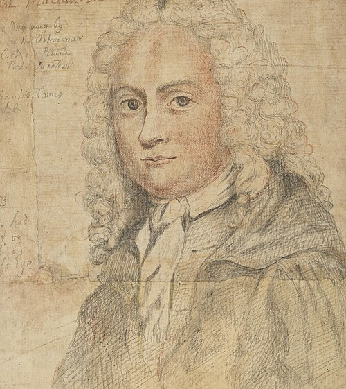

# 科林·麦克劳林

**英文名：** Colin Maclaurin

**生卒：** 1698年2月 — 1746年6月14日

**主要领域：** 流体力学、引力、数学物理

肖像的作者、拍摄或创作年代及具体形式见图片来源。

## 生平简介

苏格兰数学家，曾在阿伯丁与爱丁堡任教，是牛顿方法的重要阐释者。他把分析、几何和物理问题联系起来，研究旋转流体的平衡形状、引力和潮汐，其著作促进牛顿数学传统传播。

## 对物理的主要贡献

- 研究均匀旋转流体的椭球平衡形状，即麦克劳林椭球。
- 发展分析及级数方法，并把它们用于引力、潮汐和机械问题。

## 史料说明

- 确切生日没有可靠共识，只记1698年2月。

## 肖像来源与许可

- 来源：[Colin_Maclaurin_(Buchan-Ferguson).jpg](https://commons.wikimedia.org/wiki/File:Colin_Maclaurin_(Buchan-Ferguson).jpg)
- 作者／署名：David Steuart Erskine
- 许可：Public domain
- 本地文件：[04c285be6447d0f37354-080d7abe39.jpg](../portraits/04c285be6447d0f37354-080d7abe39.jpg)
- 原始来源说明：downloaded from https://www.nationalgalleries.org/art-and-artists/3143/colin-maclaurin-1698-1746-mathematician

## 资料来源

- [MacTutor History of Mathematics — Colin Maclaurin](https://mathshistory.st-andrews.ac.uk/Biographies/Maclaurin/)
- [Wikipedia — Colin Maclaurin](https://en.wikipedia.org/wiki/Colin_Maclaurin)

资料整理日期：2026-10-26。
