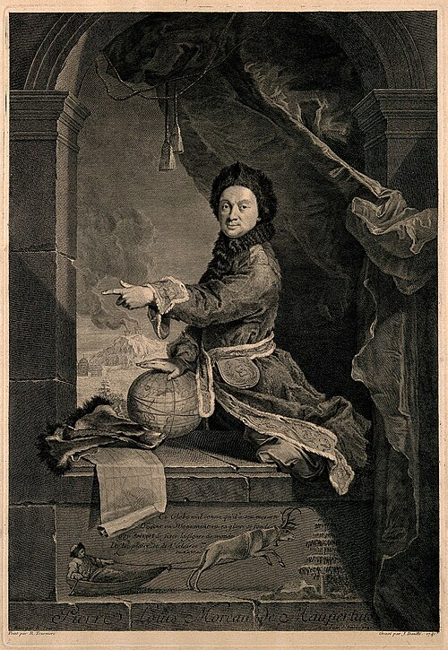

# 皮埃尔·路易·莫佩尔蒂

**英文名：** Pierre Louis Maupertuis

**生卒：** 1698年9月28日 — 1759年7月27日

**主要领域：** 大地测量、变分原理

肖像的作者、拍摄或创作年代及具体形式见图片来源。

## 生平简介

法国数学家和天文学家，曾领导拉普兰子午线弧测量，后主持柏林科学院。他用地球测量检验牛顿关于地球形状的预言，也提出作用量的极值观念，其哲学论述和优先权争议影响十八世纪科学。

## 对物理的主要贡献

- 通过拉普兰测量支持地球两极扁平的形状。
- 提出早期最小作用量原则，推动变分思想在自然理论中的发展。

## 肖像来源与许可

- 来源：[PierreLouisMaupertuis.jpg](https://commons.wikimedia.org/wiki/File:PierreLouisMaupertuis.jpg)
- 作者／署名：见原图页面
- 许可：Public domain
- 本地文件：[71107fd015ba7b6437d9-7577042ef4.jpg](../portraits/71107fd015ba7b6437d9-7577042ef4.jpg)

## 资料来源

- [MacTutor History of Mathematics — Pierre Louis Maupertuis](https://mathshistory.st-andrews.ac.uk/Biographies/Maupertuis/)
- [Wikipedia — Pierre Louis Maupertuis](https://en.wikipedia.org/wiki/Pierre_Louis_Maupertuis)

资料整理日期：2026-10-26。
