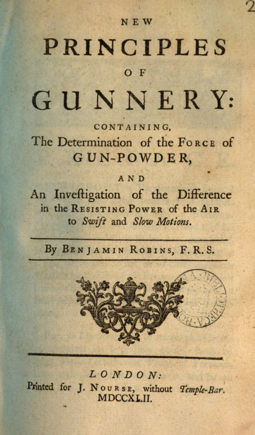

# 本杰明·罗宾斯

**英文名：** Benjamin Robins

**生卒：** 约1706—1707年 — 1751年7月20日

**主要领域：** 弹道学、实验力学

未取得可核实且适用的人物肖像。此图为罗宾斯1742年《火炮原理新论》扉页，属于著作图像，不是人物肖像。

## 生平简介

英国数学家和工程师，出身贵格会家庭，研究牛顿数学、炮术与空气阻力，后来赴印度工作。他在1742年《炮术新原理》中把实验速度测量用于弹道，改变依靠经验的火炮研究方式。

## 对物理的主要贡献

- 发明弹道摆，以动量传递测量弹丸速度。
- 研究高速弹丸的空气阻力，将实验测量和数学分析用于弹道学。

## 史料说明

- 出生年常记1707，MacTutor依据教友会记录记1706年4月16日；本档保留约1706—1707年。

## 肖像来源与许可

- 来源：[audit-early-cec206f8b510.png](https://commons.wikimedia.org/wiki/File:Benjamin_Robins.png)
- 作者／署名：Benjamin Robins
- 许可：[Public domain, as recorded by Wikimedia Commons](https://creativecommons.org/publicdomain/mark/1.0/)
- 本地文件：[cec206f8b51066149cae-a9824872e5.png](../portraits/cec206f8b51066149cae-a9824872e5.png)
- 原始来源说明：Benjamin Robins

## 资料来源

- [MacTutor History of Mathematics — Benjamin Robins](https://mathshistory.st-andrews.ac.uk/Biographies/Robins/)
- [Wikipedia — Benjamin Robins](https://en.wikipedia.org/wiki/Benjamin_Robins)

资料整理日期：2026-10-26。
