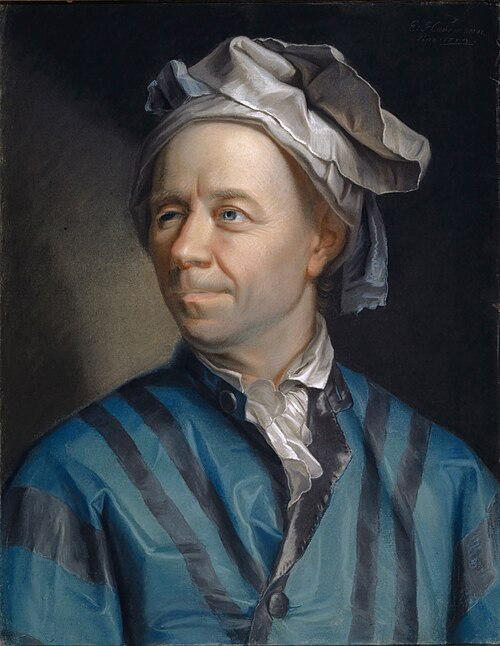

# 莱昂哈德·欧拉

**英文名：** Leonhard Euler

**生卒：** 1707年4月15日 — 1783年9月18日

**主要领域：** 流体力学、刚体力学、数学物理

肖像的作者、拍摄或创作年代及具体形式见图片来源。

## 生平简介

瑞士数学家和物理学家，先后在圣彼得堡与柏林科学院工作，晚年失明后仍持续研究。他把微积分、微分方程和变分法系统用于力学、流体及光学，是十八世纪数学物理最重要的建设者之一。

## 对物理的主要贡献

- 建立理想流体运动的欧拉方程，推进连续介质力学。
- 发展刚体转动方程和分析力学方法。
- 以变分方法及微分方程研究光学、振动与天体运动。

## 肖像来源与许可

- 来源：[Leonhard_Euler_-_Jakob_Emanuel_Handmann_(Kunstmuseum_Basel).jpg](https://commons.wikimedia.org/wiki/File:Leonhard_Euler_-_Jakob_Emanuel_Handmann_%28Kunstmuseum_Basel%29.jpg)
- 作者／署名：Jakob Emanuel Handmann (1718–1781)
- 许可：[Public domain](https://commons.wikimedia.org/wiki/Commons:Reuse_of_PD-Art_photographs)
- 本地文件：[3ca03ac443c0d035ffdb.jpg](../portraits/3ca03ac443c0d035ffdb.jpg)
- 原始来源说明：This file was derived from: Leonhard Euler.jpg Edited by: Bammesk Original source: Kunstmuseum Basel

## 资料来源

- [MacTutor History of Mathematics — Leonhard Euler](https://mathshistory.st-andrews.ac.uk/Biographies/Euler/)
- [Wikipedia — Leonhard Euler](https://en.wikipedia.org/wiki/Leonhard_Euler)

资料整理日期：2026-10-26。
