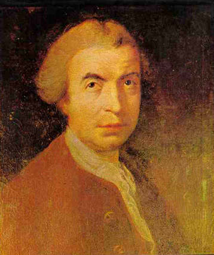

# 鲁杰尔·博什科维奇

**英文名：** Roger Joseph Boscovich

**生卒：** 1711年5月18日 — 1787年2月13日

**主要领域：** 物质理论史、理论力学、天文学

肖像的作者、拍摄或创作年代及具体形式见图片来源。

## 生平简介

出生于拉古萨的耶稣会学者，曾在罗马任教，后在意大利与法国工作。他兼事天文、测地和外交，试图以点状物质与距离相关作用力建立统一自然理论，在十八世纪物质结构观念史中占有独特位置。

## 对物理的主要贡献

- 提出以物质点和随距离变化的作用力描述物质的理论。
- 研究轨道确定及大地测量，尝试用统一力学原则解释物质性质。

## 肖像来源与许可

- 来源：[Rudjer_Boskovic.jpg](https://commons.wikimedia.org/wiki/File:Rudjer_Boskovic.jpg)
- 作者／署名：见原图页面
- 许可：[Public domain](https://commons.wikimedia.org/wiki/Commons:Reuse_of_PD-Art_photographs)
- 本地文件：[b8b2af176a5b96ecadf8.jpg](../portraits/b8b2af176a5b96ecadf8.jpg)

## 资料来源

- [MacTutor History of Mathematics — Roger Joseph Boscovich](https://mathshistory.st-andrews.ac.uk/Biographies/Boscovich/)
- [Wikipedia — Roger Joseph Boscovich](https://en.wikipedia.org/wiki/Roger_Joseph_Boscovich)

资料整理日期：2026-10-26。
