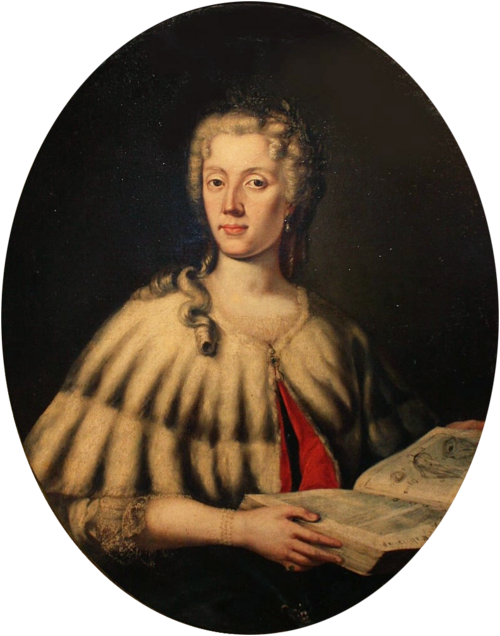

# 劳拉·巴西

**英文名：** Laura Bassi

**生卒：** 1711年10月29日 — 1778年2月20日

**主要领域：** 实验物理、电学、流体力学

肖像的作者、拍摄或创作年代及具体形式见图片来源。

## 生平简介

意大利物理学家，1732年在博洛尼亚获学位并获得有薪大学教学职位，后来担任实验物理教席。她与丈夫韦拉蒂共同建立家庭实验室，研究电、流体和光学，并在限制女性教育的环境中长期教授牛顿物理。

## 对物理的主要贡献

- 通过教学、实验和学术交流推进牛顿物理在意大利传播。
- 研究电学、流体力学和光学，发展家庭实验室中的实验教学与研究。

## 史料说明

- 出生日期采用博洛尼亚大学档案及纪念资料的1711年10月29日；MacTutor及部分资料列31日。

## 肖像来源与许可

- 来源：[Carlo_Vandi_-_Ritratto_di_Laura_Bassi_-_Museo_Europeo_degli_Studenti.png](https://commons.wikimedia.org/wiki/File:Carlo_Vandi_-_Ritratto_di_Laura_Bassi_-_Museo_Europeo_degli_Studenti.png)
- 作者／署名：Carlo Vandi
- 许可：Public domain
- 本地文件：[ad17ed90ab6230f7bc88-bcbdb2c64d.png](../portraits/ad17ed90ab6230f7bc88-bcbdb2c64d.png)
- 原始来源说明：https://www.meisterdrucke.es/impresion-art%C3%ADstica/Carlo-Vandi/771741/Retrato-de-Laura-Bassi-1711-1778,-mediados-del-siglo-XVIII..html

## 资料来源

- [MacTutor History of Mathematics — Laura Bassi](https://mathshistory.st-andrews.ac.uk/Biographies/Bassi/)
- [University of Bologna Historical Archive — Laura Bassi Veratti](https://archiviostorico.unibo.it/it/patrimonio-documentario/ritratti-di-docenti?record=95198)
- [University of Bologna Magazine — Laura Bassi compie trecento anni](https://magazine.unibo.it/it/articoli/laura_bassi_compie_trecento_anni)
- [Wikipedia — Laura Bassi](https://en.wikipedia.org/wiki/Laura_Bassi)

资料整理日期：2026-10-26。
