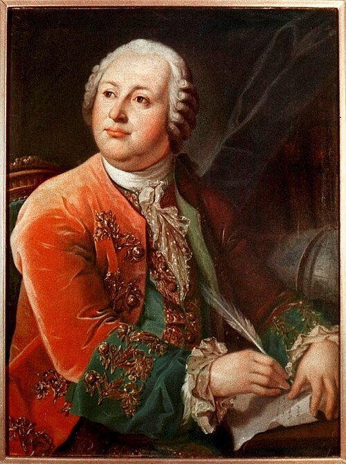

# 米哈伊尔·罗蒙诺索夫

**英文名：** Mikhail Lomonosov

**生卒：** 1711年11月19日 — 1765年4月15日（公历）

**主要领域：** 热学史、物质理论、实验物理

肖像的作者、拍摄或创作年代及具体形式见图片来源。

## 生平简介

俄罗斯科学家、教育家与作家，出身北方乡村，先后在莫斯科、圣彼得堡及德国学习。他在圣彼得堡科学院从事化学和物理研究，推动俄国科学教育，并参与莫斯科大学的创办。

## 对物理的主要贡献

- 以微粒运动观点解释热现象，反对把热仅视作独立物质。
- 研究气体、电学和光学现象，推动实验与定量分析在俄国的发展。

## 史料说明

- 生卒日采用公历1711年11月19日、1765年4月15日；相应儒略历为11月8日和4月4日。

## 肖像来源与许可

- 来源：[M.V._Lomonosov_by_L.Miropolskiy_after_G.C.Prenner_(1787,_RAN).jpg](https://commons.wikimedia.org/wiki/File:M.V._Lomonosov_by_L.Miropolskiy_after_G.C.Prenner_%281787%2C_RAN%29.jpg)
- 作者／署名：Leontiy Miropolskiy After Georg Caspar Prenner (1720–1766)
- 许可：[Public domain](https://commons.wikimedia.org/wiki/Commons:Reuse_of_PD-Art_photographs)
- 本地文件：[71778ecbf2351bea9b4f.jpg](../portraits/71778ecbf2351bea9b4f.jpg)
- 原始来源说明：http://www.ras.ru/lomonosov/b3a9efbc-bb80-4ea2-a3ea-3d68b068ed6b.aspx?hidetoc=1#

## 资料来源

- [Moscow State University — Mikhail Lomonosov](https://www.cem.chem.msu.ru/rus/history/Lomonosov/welcome.html)
- [Bank of Russia — Lomonosov commemorative biography](https://www.cbr.ru/cash_circulation/memorable_coins/coins_base/ShowCoins/?cat_num=5110-0111)
- [Wikipedia — Mikhail Lomonosov](https://en.wikipedia.org/wiki/Mikhail_Lomonosov)
- [Moscow State University Chronicle — Mikhail Lomonosov](https://letopis.msu.ru/node/5555)

资料整理日期：2026-10-26。
