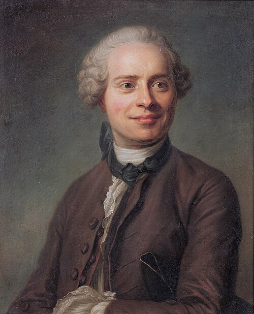

# 让·勒朗·达朗贝尔

**英文名：** Jean le Rond d'Alembert

**生卒：** 1717年11月16日 — 1783年10月29日

**主要领域：** 分析力学、波动方程、流体力学

肖像的作者、拍摄或创作年代及具体形式见图片来源。

## 生平简介

法国数学家和启蒙思想家，出生后成为弃婴，在巴黎受教育，后来参与主编《百科全书》。他将力学问题转写为数学关系，研究振动、流体和天体运动，对微分方程及分析力学的发展影响深远。

## 对物理的主要贡献

- 提出达朗贝尔原理，把动力学与虚功形式的平衡问题联系起来。
- 建立并求解弦振动的波动方程，研究流体运动与阻力问题。

## 史料说明

- 出生日期采用法兰西学院资料的1717年11月16日；MacTutor列17日，保留此差异。

## 肖像来源与许可

- 来源：[Jean_Le_Rond_d'Alembert,_by_French_school.jpg](https://commons.wikimedia.org/wiki/File:Jean_Le_Rond_d%27Alembert,_by_French_school.jpg)
- 作者／署名：After Maurice Quentin de La Tour
- 许可：Public domain
- 本地文件：[6532e0825fdbb927d67d-6100b0ce62.jpg](../portraits/6532e0825fdbb927d67d-6100b0ce62.jpg)
- 原始来源说明：Bonhams, London, 4 Dez 2013, lot 48

## 资料来源

- [MacTutor History of Mathematics — Jean le Rond d'Alembert](https://mathshistory.st-andrews.ac.uk/Biographies/DAlembert/)
- [Académie française — Jean Le Rond, dit d’Alembert](https://www.academie-francaise.fr/les-immortels/jean-le-rond-dit-dalembert)
- [Wikipedia — Jean le Rond d'Alembert](https://en.wikipedia.org/wiki/Jean_le_Rond_d%27Alembert)

资料整理日期：2026-10-26。
