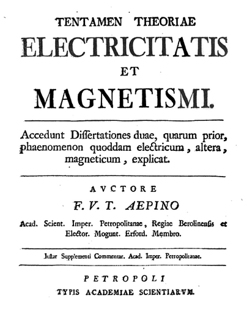

# 弗朗茨·埃皮努斯

**英文名：** Franz Aepinus

**生卒：** 1724年12月13日 — 1802年8月10日

**主要领域：** 静电学、磁学、热释电

未取得可核实且适用的人物肖像。此图为埃皮努斯1759年《电与磁理论的尝试》扉页，属于著作图像，不是人物肖像。

## 生平简介

德意志出身的物理学家，曾在柏林工作，后长期服务圣彼得堡科学院。他把电与磁置于共同的数学框架中研究，并研究电气石受热后的电现象，1759年发表电磁理论的重要著作。

## 对物理的主要贡献

- 用数学化的单流体电理论描述静电感应等现象。
- 研究电气石的热释电现象，并尝试统一分析电与磁的作用。

## 史料说明

- 其电流体理论是历史模型，不等同于现代电子或电磁场理论。

## 肖像来源与许可

- 来源：[audit-early-3facda4f6297.png](https://commons.wikimedia.org/wiki/File:Aepinus.png)
- 作者／署名：Franz Aepinus
- 许可：[Public domain, as recorded by Wikimedia Commons](https://creativecommons.org/publicdomain/mark/1.0/)
- 本地文件：[3facda4f629773f1f235-fbe5163674.png](../portraits/3facda4f629773f1f235-fbe5163674.png)
- 原始来源说明：Franz Aepinus

## 资料来源

- [MacTutor History of Mathematics — Franz Aepinus](https://mathshistory.st-andrews.ac.uk/Biographies/Aepinus/)
- [Wikipedia — Franz Aepinus](https://en.wikipedia.org/wiki/Franz_Aepinus)

资料整理日期：2026-10-26。
