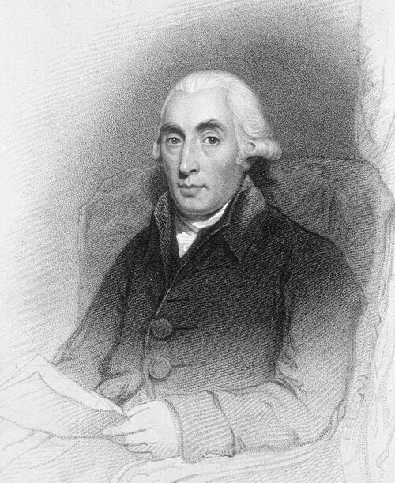

# 约瑟夫·布莱克

**英文名：** Joseph Black

**生卒：** 1728年4月16日 — 1799年12月6日

**主要领域：** 热学、量热学

肖像的作者、拍摄或创作年代及具体形式见图片来源。

## 生平简介

苏格兰医生、化学家和热学研究者，出生于波尔多，曾在格拉斯哥及爱丁堡任教。他通过精密称量研究气体，也在相变实验中区分温度与热量，对蒸汽技术和后来量热学产生重要影响。

## 对物理的主要贡献

- 提出并研究潜热，说明相变可吸收热量而温度不随之升高。
- 发展比热和热容量概念，推动定量量热研究。

## 肖像来源与许可

- 来源：[Joseph_Black_b1728.jpg](https://commons.wikimedia.org/wiki/File:Joseph_Black_b1728.jpg)
- 作者／署名：Rogers, J
- 许可：[Public domain](https://commons.wikimedia.org/wiki/File:Joseph_Black_b1728.jpg)
- 本地文件：[5c02e2c54ff98b1468ce.jpg](../portraits/5c02e2c54ff98b1468ce.jpg)
- 原始来源说明：http://ihm.nlm.nih.gov/images/B02979

## 资料来源

- [University of Edinburgh — Joseph Black](https://chem.ed.ac.uk/about-us/history/professors/joseph-black)
- [Wikipedia — Joseph Black](https://en.wikipedia.org/wiki/Joseph_Black)

资料整理日期：2026-10-26。
