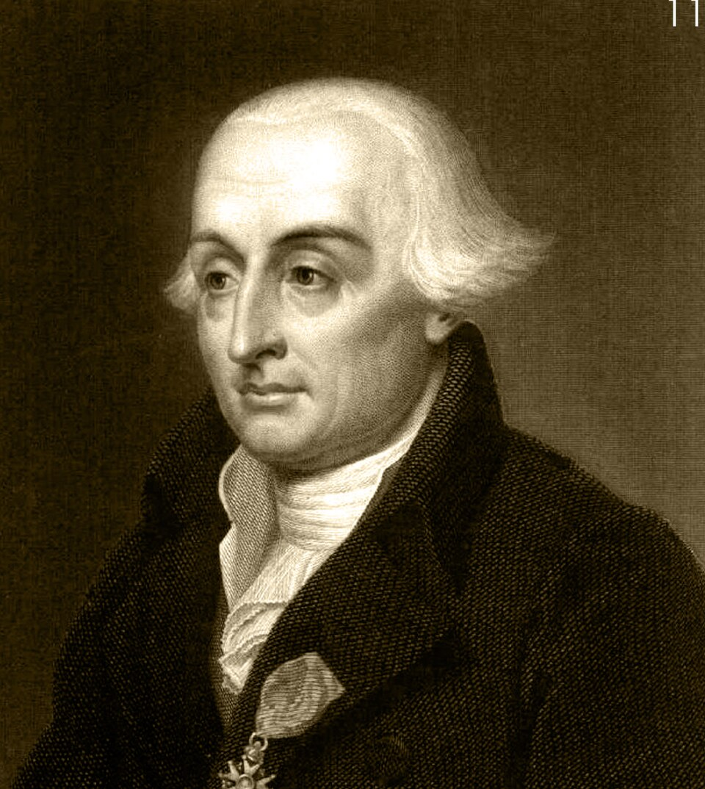

# 约瑟夫·路易·拉格朗日

**英文名：** Joseph-Louis Lagrange

**生卒：** 1736年1月25日 — 1813年4月10日

**主要领域：** 分析力学、变分法、天体力学

肖像的作者、拍摄或创作年代及具体形式见图片来源。

## 生平简介

出生于都灵的数学家，先后在都灵、柏林和巴黎工作。他把变分法与牛顿力学结合，在《分析力学》中以一般化方法处理复杂系统，减少对专门几何图解的依赖，奠定现代分析力学的重要基础。

## 对物理的主要贡献

- 建立以广义坐标和拉格朗日方程描述机械系统的方法。
- 发展变分法及约束处理，统一静力学与动力学计算。
- 研究三体问题和轨道稳定性，发现特殊平衡解。

## 肖像来源与许可

- 来源：[Lagrange_crop.jpg](https://commons.wikimedia.org/wiki/File:Lagrange_crop.jpg)
- 作者／署名：Unknown author
- 许可：[CC0](https://commons.wikimedia.org/wiki/File:Lagrange_crop.jpg)
- 本地文件：[d5eb7b86037356e53e07.jpg](../portraits/d5eb7b86037356e53e07.jpg)
- 原始来源说明：File:Joseph_Louis_Lagrange.jpg

## 资料来源

- [MacTutor History of Mathematics — Joseph-Louis Lagrange](https://mathshistory.st-andrews.ac.uk/Biographies/Lagrange/)
- [Wikipedia — Joseph-Louis Lagrange](https://en.wikipedia.org/wiki/Joseph-Louis_Lagrange)

资料整理日期：2026-10-26。
