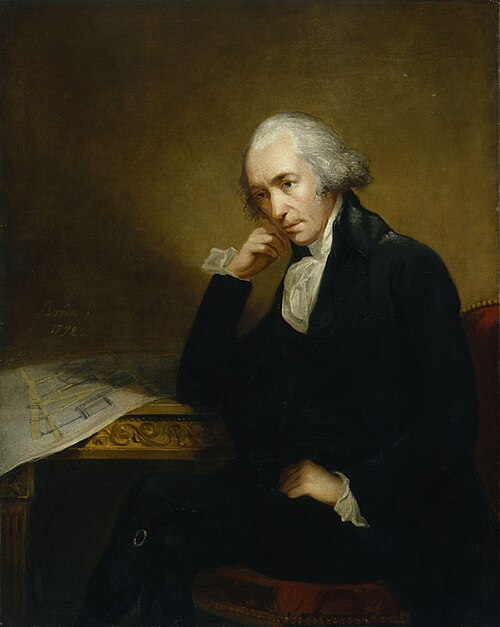

# 詹姆斯·瓦特

**英文名：** James Watt

**生卒：** 1736年1月30日 — 1819年8月25日

**主要领域：** 热机工程、应用热学

肖像的作者、拍摄或创作年代及具体形式见图片来源。

## 生平简介

苏格兰仪器制造者和工程师，早年在格拉斯哥大学附近工作，修理教学用蒸汽机时开始改进其设计。后来与博尔顿合作推广高效蒸汽动力，使热学知识、精密制造和工业应用紧密结合。

## 对物理的主要贡献

- 发明独立冷凝器，大幅减少汽缸反复冷却造成的热损失。
- 改进蒸汽机的传动、控制和动力利用，推动热机工程的规模化应用。

## 史料说明

- 出生日期采用公历1736年1月30日；科学博物馆所列1月19日为儒略历旧式日期。

## 肖像来源与许可

- 来源：[Watt_James_von_Breda.jpg](https://commons.wikimedia.org/wiki/File:Watt_James_von_Breda.jpg)
- 作者／署名：Carl Frederik von Breda
- 许可：Public domain
- 本地文件：[ea3d76712e6305fd52e7.jpg](../portraits/ea3d76712e6305fd52e7.jpg)
- 原始来源说明：one or more third parties have made copyright claims against Wikimedia Commons in relation to the work from which this is sourced or a purely mechanical reproduction thereof. This may be due to recognition of the "sweat of the brow" doctrine, allowing works to be eligible for protection through skill and labour, and not purely by originality as is the case in the United States (where this website is hosted). These claims may or may not be valid in all jurisdictions. As such, use of this image in the jurisdiction of the claimant or other countries may be regarded as copyright infringement. Please see Commons:When to use the PD-Art tag for more information.

## 资料来源

- [Science Museum Group — James Watt](https://collection.sciencemuseumgroup.org.uk/people/ap24508/watt-james)
- [Wikipedia — James Watt](https://en.wikipedia.org/wiki/James_Watt)

资料整理日期：2026-10-26。
