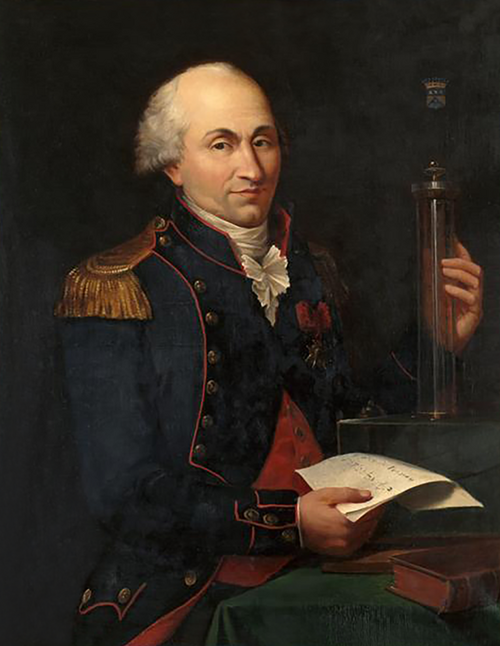

# 夏尔·奥古斯丁·库仑

**英文名：** Charles-Augustin de Coulomb

**生卒：** 1736年6月14日 — 1806年8月23日

**主要领域：** 静电学、实验力学、摩擦学

肖像的作者、拍摄或创作年代及具体形式见图片来源。

## 生平简介

法国军事工程师和实验物理学家，曾在海外及法国从事工事建设。他由土木与机械问题转向电磁相互作用的精密测量，利用扭转装置研究弱力，其名字成为电荷单位。

## 对物理的主要贡献

- 通过扭秤实验确立静电作用的平方反比规律。
- 研究摩擦、扭转和土体稳定，为应用力学与测量仪器提供定量关系。

## 肖像来源与许可

- 来源：[Charles_de_Coulomb.png](https://commons.wikimedia.org/wiki/File:Charles_de_Coulomb.png)
- 作者／署名：Louis Hierle
- 许可：Public domain
- 本地文件：[1a9609c4530186c99a2d.png](../portraits/1a9609c4530186c99a2d.png)
- 原始来源说明：Unknown sourceUnknown source

## 资料来源

- [MacTutor History of Mathematics — Charles-Augustin de Coulomb](https://mathshistory.st-andrews.ac.uk/Biographies/Coulomb/)
- [Wikipedia — Charles-Augustin de Coulomb](https://en.wikipedia.org/wiki/Charles-Augustin_de_Coulomb)

资料整理日期：2026-10-26。
