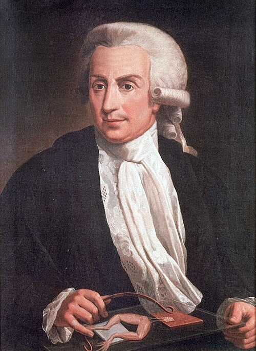

# 路易吉·伽伐尼

**英文名：** Luigi Galvani

**生卒：** 1737年9月9日 — 1798年12月4日

**主要领域：** 生物电学、电学史

肖像的作者、拍摄或创作年代及具体形式见图片来源。

## 生平简介

意大利医生、解剖学家和博洛尼亚大学教师，长期研究神经、肌肉与电刺激。他通过蛙腿实验提出“动物电”观念，与伏打的争论促使科学界区分生物组织电活动和异种金属接触形成的电源效应。

## 对物理的主要贡献

- 揭示电刺激与肌肉收缩之间的关系，开创实验电生理学。
- 其动物电研究推动电现象、神经传导与电池机制的进一步实验。

## 肖像来源与许可

- 来源：[Luigi_Galvani,_oil-painting.jpg](https://commons.wikimedia.org/wiki/File:Luigi_Galvani%2C_oil-painting.jpg)
- 作者／署名：Unidentified painter
- 许可：[Public domain](https://commons.wikimedia.org/wiki/Commons:Reuse_of_PD-Art_photographs)
- 本地文件：[db65180cfb3167a70bc3.jpg](../portraits/db65180cfb3167a70bc3.jpg)
- 原始来源说明：http://www.museopalazzopoggi.unibo.it//poggi_eng/palazzo/foto/prot http://biografieonline.it/foto-di.htm?n=Luigi+Galvani

## 资料来源

- [University of Bologna — Luigi Galvani](https://www.unibo.it/it/ateneo/chi-siamo/la-nostra-storia/alumni-e-personaggi-celebri/luigi-galvani)
- [Treccani — Luigi Galvani](https://www.treccani.it/enciclopedia/luigi-galvani_%28Enciclopedia-Italiana%29/)
- [Wikipedia — Luigi Galvani](https://en.wikipedia.org/wiki/Luigi_Galvani)

资料整理日期：2026-10-26。
