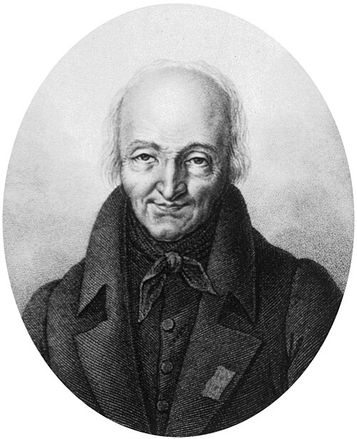

# 勒内·朱斯特·阿维

**英文名：** René Just Haüy

**生卒：** 1743年2月28日 — 1822年6月1日或3日

**主要领域：** 晶体学、矿物物理

肖像的作者、拍摄或创作年代及具体形式见图片来源。

## 生平简介

法国神父和矿物学家，长期在巴黎从事教学与收藏研究。他从晶体的解理和几何形状出发，提出用规则微小单元组合解释晶体外形，并研究矿物的物理性质，是几何晶体学的重要奠基者。

## 对物理的主要贡献

- 以结构单元与有理几何关系解释晶体外形，推进几何晶体学。
- 研究矿物的解理、对称性及电学等物理性质，促进矿物学与物理的联系。

## 史料说明

- 卒日有1822年6月1日与3日两说；后者亦被解释为安葬日，故保留月份与差异。

## 肖像来源与许可

- 来源：[René_Just_Haüy_2.jpg](https://commons.wikimedia.org/wiki/File:Ren%C3%A9_Just_Ha%C3%BCy_2.jpg)
- 作者／署名：Ambroise Tardieu (1788-1841)
- 许可：Public domain
- 本地文件：[89ed7de9bc5fa3b47821-58a069d3b6.jpg](../portraits/89ed7de9bc5fa3b47821-58a069d3b6.jpg)
- 原始来源说明：http://digitalgallery.nypl.org/nypldigital/dgkeysearchdetail.cfm?trg=1&strucID=1762983&imageID=1624797&total=6&num=0&word=Tardieu%2C%20Ambroise&s=3¬word=&d=&c=&f=4&k=0&lWord=&lField=&sScope=&sLevel=&sLabel=&imgs=20&pos=5&e=w

## 资料来源

- [Royal Society — René Just Haüy](https://catalogues.royalsociety.org/calmview/Record.aspx?id=NA3462&src=CalmView.Persons)
- [Wikipedia — René Just Haüy](https://en.wikipedia.org/wiki/Ren%C3%A9_Just_Ha%C3%BCy)

资料整理日期：2026-10-26。
