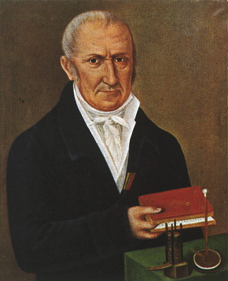

# 亚历山德罗·伏打

**英文名：** Alessandro Volta

**生卒：** 1745年2月18日 — 1827年3月5日

**主要领域：** 电学、电源技术、实验物理

肖像的作者、拍摄或创作年代及具体形式见图片来源。

## 生平简介

意大利物理学家，出生于科莫，曾任帕维亚大学实验物理教授。他长期研究静电与气体，并在检验伽伐尼动物电实验时提出不同解释，最终制成可持续供电的伏打电堆，开启电流实验的新阶段。

## 对物理的主要贡献

- 发明伏打电堆，为持续电流研究提供可靠电源。
- 研究接触电及电势差，改进起电盘和电学测量仪器。

## 肖像来源与许可

- 来源：[Alessandro_Volta.jpeg](https://commons.wikimedia.org/wiki/File:Alessandro_Volta.jpeg)
- 作者／署名：见原图页面
- 许可：Public domain
- 本地文件：[12fcea74a54864515476.jpeg](../portraits/12fcea74a54864515476.jpeg)
- 原始来源说明：https://www.anthroposophie.net/bibliothek/nawi/physik/volta/bib_volta.htm

## 资料来源

- [Museo Galileo — Alessandro Volta](https://catalogue.museogalileo.it/biography/AlessandroVolta.html)
- [Wikipedia — Alessandro Volta](https://en.wikipedia.org/wiki/Alessandro_Volta)
- [Treccani, Enciclopedia Italiana — Alessandro Volta](https://www.treccani.it/enciclopedia/alessandro-volta_(Enciclopedia-Italiana)/)

资料整理日期：2026-10-26。
