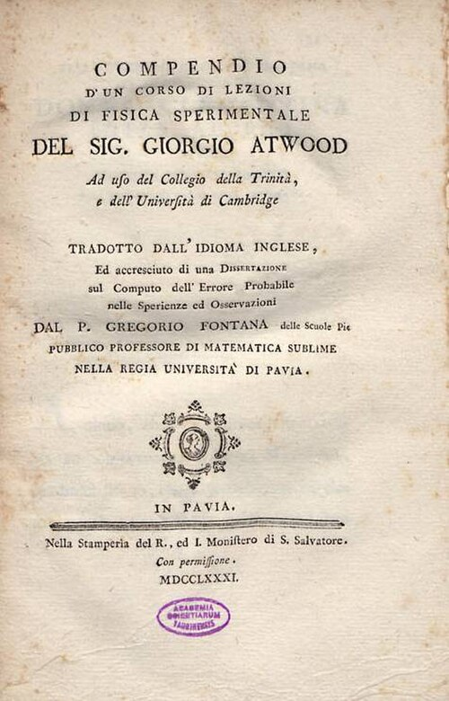

# 乔治·阿特伍德

**英文名：** George Atwood

**生卒：** 1745年10月 — 1807年7月11日

**主要领域：** 实验力学、精密测量

未取得可核实且适用的人物肖像。此图为阿特伍德实验物理讲义说明的1781年意大利译本扉页（BEIC馆藏），属于著作图像，不是人物肖像。

## 生平简介

英国数学家和实验物理教师，曾在剑桥任教并成为皇家学会成员。他设计低摩擦的滑轮与重物装置，借较小的加速度检验落体运动，也研究摆、力学教学及船舶稳定问题。

## 对物理的主要贡献

- 发明阿特伍德机，使重力作用下的加速运动便于定量演示和测量。
- 通过仪器与教学研究传播牛顿力学，并研究摆和机械平衡。

## 史料说明

- 1745年10月15日为受洗日，出生日期仅保留到月份。

## 肖像来源与许可

- 来源：[audit-early-atwood.jpg](https://commons.wikimedia.org/wiki/File:Atwood%2C_George_%E2%80%93_Description_of_the_experiments%2C_intended_to_illustrate_a_course_of_lectures%2C_on_the_principles_of_natural_philosophy%2C_1781_%E2%80%93_BEIC_586027.jpg)
- 作者／署名：George Atwood / BEIC
- 许可：[Public domain, as recorded by Wikimedia Commons](https://creativecommons.org/publicdomain/mark/1.0/)
- 本地文件：[8ad125027d1652b81b04-ef42a1ef1c.jpg](../portraits/8ad125027d1652b81b04-ef42a1ef1c.jpg)
- 原始来源说明：George Atwood / BEIC

## 资料来源

- [MacTutor History of Mathematics — George Atwood](https://mathshistory.st-andrews.ac.uk/Biographies/Atwood/)
- [Wikipedia — George Atwood](https://en.wikipedia.org/wiki/George_Atwood)

资料整理日期：2026-10-26。
