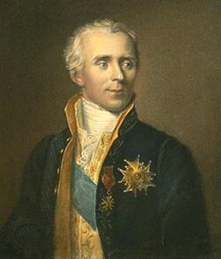

# 皮埃尔·西蒙·拉普拉斯

**英文名：** Pierre-Simon Laplace

**生卒：** 1749年3月23日 — 1827年3月5日

**主要领域：** 天体力学、势理论、数学物理

肖像的作者、拍摄或创作年代及具体形式见图片来源。

## 生平简介

法国数学家和天文学家，长期在巴黎学术机构工作，也曾参与公共事务。他运用微积分和概率方法研究引力系统、天体运动及物理过程，代表作《天体力学》系统推进了牛顿理论的分析化。

## 对物理的主要贡献

- 发展天体摄动理论，研究行星和卫星运动的长期变化。
- 建立势理论中的拉普拉斯方程，广泛用于引力、静电和流体问题。
- 与拉瓦锡合作开展量热实验，并研究声速及毛细现象。

## 肖像来源与许可

- 来源：[Laplace,_Pierre-Simon,_marquis_de.jpg](https://commons.wikimedia.org/wiki/File:Laplace%2C_Pierre-Simon%2C_marquis_de.jpg)
- 作者／署名：James Posselwhite (1798–1884)
- 许可：[Public domain](https://commons.wikimedia.org/wiki/Commons:Reuse_of_PD-Art_photographs)
- 本地文件：[7616eb732c4c8805380f.jpg](../portraits/7616eb732c4c8805380f.jpg)
- 原始来源说明：www.britannica.com

## 资料来源

- [MacTutor History of Mathematics — Pierre-Simon Laplace](https://mathshistory.st-andrews.ac.uk/Biographies/Laplace/)
- [Wikipedia — Pierre-Simon Laplace](https://en.wikipedia.org/wiki/Pierre-Simon_Laplace)

资料整理日期：2026-10-26。
