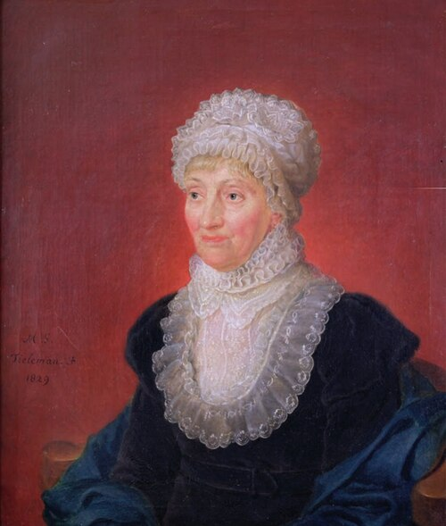

# 卡罗琳·赫歇尔

**英文名：** Caroline Herschel

**生卒：** 1750年3月16日 — 1848年1月9日

**主要领域：** 观测天文学、天文目录

肖像的作者、拍摄或创作年代及具体形式见图片来源。

## 生平简介

出生于汉诺威的天文学家，移居英国后与兄长威廉长期合作，承担观测、计算和目录整理。她也独立发现彗星和星云，后来获得皇家天文学会奖章，是早期获得科学工作报酬的重要女性天文学家。

## 对物理的主要贡献

- 独立发现多颗彗星并观测星云。
- 整理、校订和扩充恒星与星云目录，提升天体观测资料的可靠性。

## 肖像来源与许可

- 来源：[1829_Melchior_Gommar_Tieleman,_Ölgemälde_Caroline_Herschel_Hannover.tif](https://commons.wikimedia.org/wiki/File:1829_Melchior_Gommar_Tieleman,_%C3%96lgem%C3%A4lde_Caroline_Herschel_Hannover.tif)
- 作者／署名：Ölgemälde: Melchior Gommar Tieleman; Foto des gemeinfreien Gemäldes: unbekannt
- 许可：Public domain
- 本地文件：[04126a00c344d3ff5a83-3dcf1173ec.jpg](../portraits/04126a00c344d3ff5a83-3dcf1173ec.jpg)
- 原始来源说明：Michael Hoskin: Discoverers of the Universe: William and Caroline Herschel, book preview: https://books.google.de/books?id=8MzDas3GeJMC&pg=PA142-IA14&dq=Melchior+gommar+Tielemann+1784+1864&hl=de&sa=X&ved=0ahUKEwiAnJTx9afZAhXQzaQKHXVjCb8Q6AEIODAC#v=onepage&q&f=false

## 资料来源

- [MacTutor History of Mathematics — Caroline Herschel](https://mathshistory.st-andrews.ac.uk/Biographies/Herschel_Caroline/)
- [Wikipedia — Caroline Herschel](https://en.wikipedia.org/wiki/Caroline_Herschel)

资料整理日期：2026-10-26。
