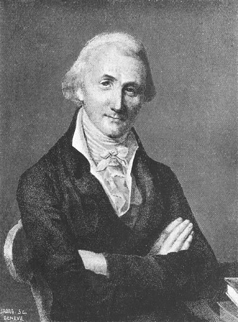

# 皮埃尔·普雷沃斯特

**英文名：** Pierre Prévost

**生卒：** 1751年3月3日 — 1839年4月8日

**主要领域：** 热辐射、热学史

1896年刊载的普雷沃历史版画，与《瑞士历史辞典》所载据菲尔曼·马索约1810年生前肖像制作的版画相符；本文件具体刻制年代尚未核实，不应把1896年刊载时间当作原肖像创作时间。

## 生平简介

日内瓦哲学家和物理学家，早年学习法律，曾在柏林和日内瓦教授哲学，后任普通物理学教授。他研究磁性和热，1791年提出热辐射交换观念，以持续发射和吸收解释热平衡。

## 对物理的主要贡献

- 提出热辐射交换理论，说明热平衡可由双向辐射的动态平衡维持。
- 反对把“冷”作为独立辐射物质的解释，推动热辐射研究的概念转变。

## 肖像来源与许可

- 来源：[audit-early-f97aaaf90811.jpg](https://commons.wikimedia.org/wiki/File:Physicist_Pierre_Pr%C3%A9vost.jpg)
- 作者／署名：Journal Officiel Illustré de l’Exposition Nationale Suisse, Genève (1896)
- 许可：[Public domain, as recorded by Wikimedia Commons](https://creativecommons.org/publicdomain/mark/1.0/)
- 本地文件：[f97aaaf908111a89c5f4-30ecf70f6d.jpg](../portraits/f97aaaf908111a89c5f4-30ecf70f6d.jpg)
- 原始来源说明：Journal Officiel Illustré de l’Exposition Nationale Suisse, Genève (1896)

## 资料来源

- [Royal Society — Pierre Prevost](https://catalogues.royalsociety.org/CalmView/Record.aspx?AddBasket=NA3134&id=NA3134&src=CalmView.Persons)
- [ETH Library — Recherches physico-mécaniques sur la chaleur, 1792](https://www.e-rara.ch/zut/content/titleinfo/1431800)
- [Wikipedia — Pierre Prévost](https://en.wikipedia.org/wiki/Pierre_Prevost_%28physicist%29)

资料整理日期：2026-10-26。
