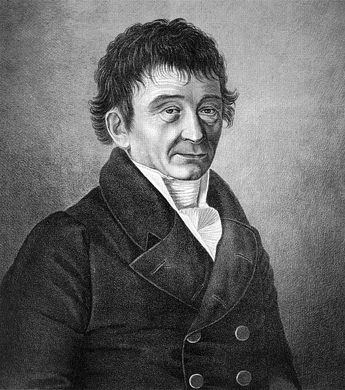

# 恩斯特·克拉德尼

**英文名：** Ernst Chladni

**生卒：** 1756年11月30日 — 1827年4月3日

**主要领域：** 声学、振动、陨石研究

肖像的作者、拍摄或创作年代及具体形式见图片来源。

## 生平简介

德意志物理学家，原受法律教育，后来转向声学，靠巡回讲演与乐器演示传播实验成果。他以砂粒显示振动板的节线，也研究声速、乐器及陨石，成为实验声学和陨石科学的重要先驱。

## 对物理的主要贡献

- 通过克拉德尼图形使板振动的模态和节线可视化。
- 研究固体及气体中的声音传播，并为陨石具有地外来源提供论证。

## 肖像来源与许可

- 来源：[Echladni.jpg](https://commons.wikimedia.org/wiki/File:Echladni.jpg)
- 作者／署名：Ludwig Albert von Montmorillon
- 许可：Public domain
- 本地文件：[65ff2d6a23461018504c-1ae8d38e4a.jpg](../portraits/65ff2d6a23461018504c-1ae8d38e4a.jpg)
- 原始来源说明：Reprinted in Marvin, U. B. (2007). "Ernst Florens Friedrich Chladni (1756–1827) and the origins of modern meteorite research" Meteoritics & Planetary Science, 42 (9): B3–B68.

## 资料来源

- [Deutsche Biographie — Ernst Florenz Friedrich Chladni](https://www.deutsche-biographie.de/gnd118520490.html?language=en)
- [Wikipedia — Ernst Chladni](https://en.wikipedia.org/wiki/Ernst_Chladni)

资料整理日期：2026-10-26。
