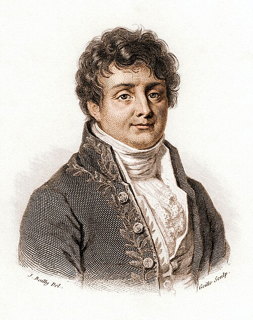

# 约瑟夫·傅里叶

**英文名：** Joseph Fourier

**生卒：** 1768年3月21日 — 1830年5月16日

**主要领域：** 热传导、数学物理

肖像的作者、拍摄或创作年代及具体形式见图片来源。

## 生平简介

法国数学家和行政官员，曾参加埃及远征，后任伊泽尔省省长并在巴黎科学院工作。他由热传导问题发展出三角级数方法，将具体物理过程与偏微分方程联系，相关方法后来遍及波动和量子理论。

## 对物理的主要贡献

- 建立热传导方程，系统研究温度场随时间的扩散。
- 发展傅里叶级数方法，为边值问题、波动和信号分析提供基础工具。

## 肖像来源与许可

- 来源：[Fourier2_-_restoration1.jpg](https://commons.wikimedia.org/wiki/File:Fourier2_-_restoration1.jpg)
- 作者／署名：Julien-Léopold Boilly
- 许可：Public domain
- 本地文件：[eb534d206cca577e0c0e.jpg](../portraits/eb534d206cca577e0c0e.jpg)
- 原始来源说明：This file was derived from: Fourier2.jpg Restored by: Bammesk Original source: https://www.gettyimages.com.au/license/169251384 https://wellcomecollection.org/works/b4qh352u

## 资料来源

- [MacTutor History of Mathematics — Joseph Fourier](https://mathshistory.st-andrews.ac.uk/Biographies/Fourier/)
- [Wikipedia — Joseph Fourier](https://en.wikipedia.org/wiki/Joseph_Fourier)

资料整理日期：2026-10-26。
