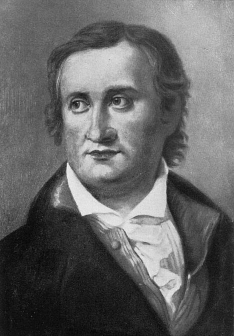

# 托马斯·约翰·塞贝克

**英文名：** Thomas Johann Seebeck

**生卒：** 1770年4月9日 — 1831年12月10日

**主要领域：** 热电效应、电磁学、温度计量

肖像的作者、拍摄或创作年代及具体形式见图片来源。

## 生平简介

出生于波罗的海地区的德意志物理研究者，曾获医学学位，后主要从事自然实验。他研究颜色、磁性与温度的关系，在异种金属回路中观察到温差引起的磁针偏转，最初将其解释为热磁现象。

## 对物理的主要贡献

- 发现异种导体回路在温差下产生电效应，即塞贝克效应。
- 开辟热电转换研究，为热电偶温度测量和热电器件奠定实验基础。

## 史料说明

- 出生日期采用公历1770年4月9日；俄历旧式日期为3月29日。

## 肖像来源与许可

- 来源：[ThomasSeebeck.jpg](https://commons.wikimedia.org/wiki/File:ThomasSeebeck.jpg)
- 作者／署名：The original uploader was Jlorenz1@web.de at German Wikipedia. (Original text: Ölbild im Familienbesitz (1932))
- 许可：Public domain
- 本地文件：[3d899a35268cad54a844.jpg](../portraits/3d899a35268cad54a844.jpg)
- 原始来源说明：Originally from de.wikipedia; Hans Wahl, Anton Kippenberg: Goethe und seine Welt, Insel-Verlag, Leipzig 1932 S.204

## 资料来源

- [E. Velmre — Thomas Johann Seebeck, Estonian Academy Publishers (2007)](https://kirj.ee/wp-content/plugins/kirj/pub/eng-4-2007-276-282_20230511160746.pdf)
- [Wikipedia — Thomas Johann Seebeck](https://en.wikipedia.org/wiki/Thomas_Johann_Seebeck)

资料整理日期：2026-10-26。
