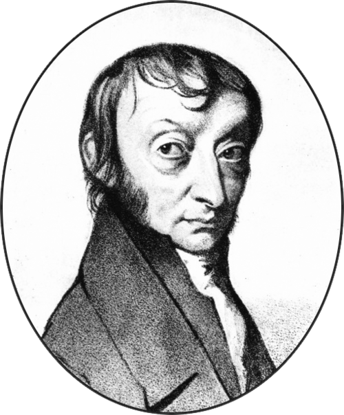

# 阿梅代奥·阿伏伽德罗

**英文名：** Amedeo Avogadro

**生卒：** 1776年8月9日 — 1856年7月9日

**主要领域：** 分子物理、气体物理

肖像的作者、拍摄或创作年代及具体形式见图片来源。

## 生平简介

意大利学者，早年受法律教育，后来转向自然科学，长期在都灵教授物理。他区分分子与原子层次的概念，1811年提出在相同条件下气体体积与粒子数之间的关系，成果经后世重估后成为分子科学基础。

## 对物理的主要贡献

- 提出同温同压下等体积气体含有相同数目分子的假说。
- 以分子观念解释气体化合体积和相对分子质量，为分子论与原子量测定提供基础。

## 肖像来源与许可

- 来源：[Amadeo_Avogadro.png](https://commons.wikimedia.org/wiki/File:Amadeo_Avogadro.png)
- 作者／署名：The original uploader was Anton at German Wikipedia.
- 许可：Public domain
- 本地文件：[342887c16e79ed3e8b93-20e2f2b3b6.png](../portraits/342887c16e79ed3e8b93-20e2f2b3b6.png)
- 原始来源说明：Transferred from de.wikipedia to Commons by Septembermorgen using CommonsHelper.

## 资料来源

- [Science History Institute — Amedeo Avogadro](https://www.sciencehistory.org/education/scientific-biographies/amedeo-avogadro/)
- [BibNum — Les deux hypothèses d’Avogadro en 1811](https://www.bibnum.education.fr/chimie/theorie-chimique/les-deux-hypotheses-d-avogadro-en-1811)
- [Wikipedia — Amedeo Avogadro](https://en.wikipedia.org/wiki/Amedeo_Avogadro)

资料整理日期：2026-10-26。
