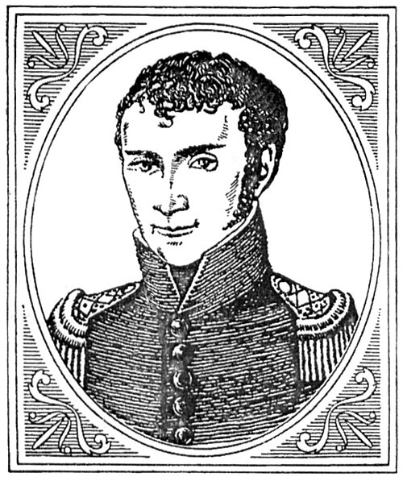

# 约翰·威廉·里特尔

**英文名：** Johann Wilhelm Ritter

**生卒：** 1776年12月16日 — 1810年1月23日

**主要领域：** 紫外光学、电化学

肖像的作者、拍摄或创作年代及具体形式见图片来源。

## 生平简介

德意志实验物理研究者，早年学习药剂学，后在耶拿等地开展电化学与光学实验，晚年任巴伐利亚科学院成员。他以化学反应探测可见紫光以外的辐射，并研究电流的化学和生理作用。

## 对物理的主要贡献

- 在太阳光谱紫端之外发现具有化学作用的不可见辐射，即紫外辐射。
- 研究电解、极化及蓄电现象，推进早期电化学。

## 肖像来源与许可

- 来源：[Ritter-Johann-Wilhelm-1804.jpg](https://commons.wikimedia.org/wiki/File:Ritter-Johann-Wilhelm-1804.jpg)
- 作者／署名：Unknown author
- 许可：Public domain
- 本地文件：[f89ebda1883fb3d9e5b4-6d1d1f491f.jpg](../portraits/f89ebda1883fb3d9e5b4-6d1d1f491f.jpg)
- 原始来源说明：http://joi.jlc.jst.go.jp/JST.JSTAGE/revpolarography/54.99?from=Google

## 资料来源

- [Deutsche Biographie — Johann Wilhelm Ritter](https://www.deutsche-biographie.de/gnd118745468.html)
- [Wikipedia — Johann Wilhelm Ritter](https://en.wikipedia.org/wiki/Johann_Wilhelm_Ritter)

资料整理日期：2026-10-26。
