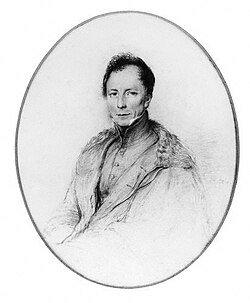

# 亨利·卡特

**英文名：** Henry Kater

**生卒：** 1777年4月16日 — 1835年4月26日

**主要领域：** 重力测量、计量学

肖像的作者、拍摄或创作年代及具体形式见图片来源。

## 生平简介

英国军人、测量学家和实验物理研究者，曾参与印度三角测量，退休后在英国研究计量仪器。他以可倒置使用的复摆改进重力测量，并研究长度、质量标准和光学准直装置。

## 对物理的主要贡献

- 发明卡特可逆摆，用于精密测定当地重力加速度。
- 改进测地、准直和计量仪器，参与长度与质量标准的比较。

## 史料说明

- 出生日期采用通行传记及历史肖像文献的1777年4月16日；个别机构简介漏作4月6日。

## 肖像来源与许可

- 来源：[Henry_Kater00.jpg](https://commons.wikimedia.org/wiki/File:Henry_Kater00.jpg)
- 作者／署名：George Richmond
- 许可：Public domain
- 本地文件：[e870125a8bf14209cf73-6cc9235d3b.jpg](../portraits/e870125a8bf14209cf73-6cc9235d3b.jpg)
- 原始来源说明：one or more third parties have made copyright claims against Wikimedia Commons in relation to the work from which this is sourced or a purely mechanical reproduction thereof. This may be due to recognition of the "sweat of the brow" doctrine, allowing works to be eligible for protection through skill and labour, and not purely by originality as is the case in the United States (where this website is hosted). These claims may or may not be valid in all jurisdictions. As such, use of this image in the jurisdiction of the claimant or other countries may be regarded as copyright infringement. Please see Commons:When to use the PD-Art tag for more information.

## 资料来源

- [National Portrait Gallery — Henry Kater](https://www.npg.org.uk/collections/search/person/mp02471/henry-kater?displayStyle=thumb)
- [Darwin Correspondence Project — Henry Kater](https://darwin-editorial.darwinproject.ac.uk/view/nameregs/nameregs_2643)
- [Wikipedia — Henry Kater](https://en.wikipedia.org/wiki/Henry_Kater)

资料整理日期：2026-10-26。
