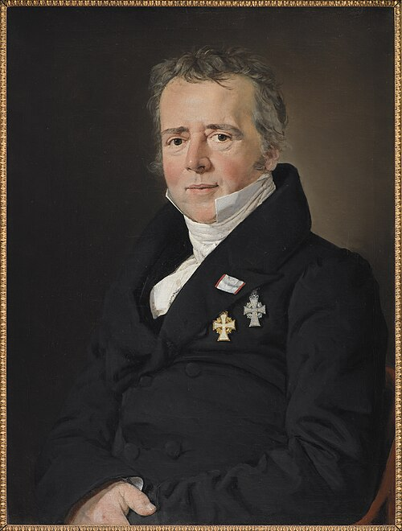

# 汉斯·克里斯蒂安·奥斯特

**英文名：** Hans Christian Ørsted

**生卒：** 1777年8月14日 — 1851年3月9日

**主要领域：** 电磁学、实验物理

肖像的作者、拍摄或创作年代及具体形式见图片来源。

## 生平简介

丹麦物理学家和化学家，长期在哥本哈根教学与研究，并推动当地科学教育和工业技术机构的发展。他关心自然作用之间的统一，在课堂相关实验中发现电流使磁针偏转，直接促进了电磁学的形成。

## 对物理的主要贡献

- 发现电流的磁效应，首次清楚展示电与磁的联系。
- 研究材料和电学现象，促进实验物理教学及电磁研究传播。

## 肖像来源与许可

- 来源：[C.A._Jensen_-_Portrait_of_the_Physicist_Hans_Christian_Ørsted_-_KMS8176_-_Statens_Museum_for_Kunst.jpg](https://commons.wikimedia.org/wiki/File:C.A._Jensen_-_Portrait_of_the_Physicist_Hans_Christian_%C3%98rsted_-_KMS8176_-_Statens_Museum_for_Kunst.jpg)
- 作者／署名：Christian Albrecht Jensen
- 许可：Public domain
- 本地文件：[367cba5cf5fa818a5f9c.jpg](../portraits/367cba5cf5fa818a5f9c.jpg)
- 原始来源说明：http://collection.smk.dk/#/en/detail/KMS8176

## 资料来源

- [Royal Society — Hans Christian Oersted](https://catalogues.royalsociety.org/CalmView/Record.aspx?id=NA7482&src=CalmView.Persons)
- [Niels Bohr Institute, University of Copenhagen — H.C. Oersted biography](https://nbi.ku.dk/english/www/hco/oersted/opvaekst)
- [Wikipedia — Hans Christian Ørsted](https://en.wikipedia.org/wiki/Hans_Christian_%C3%98rsted)

资料整理日期：2026-10-26。
