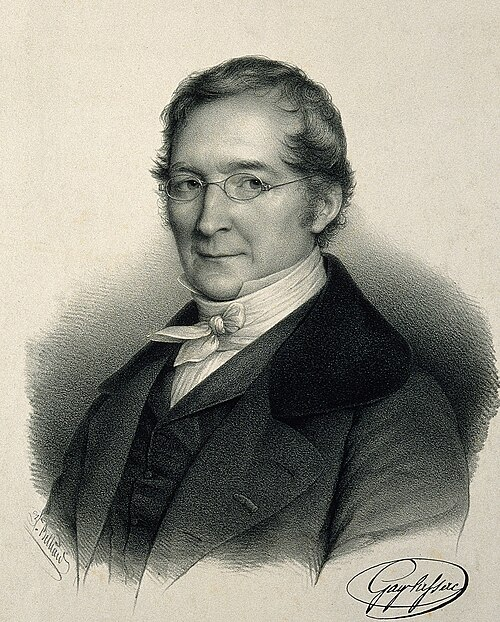

# 约瑟夫·路易·盖-吕萨克

**英文名：** Joseph Louis Gay-Lussac

**生卒：** 1778年12月6日 — 1850年5月9日

**主要领域：** 气体物理、物理化学、大气物理

肖像的作者、拍摄或创作年代及具体形式见图片来源。

## 生平简介

法国化学家和物理学家，曾在综合理工学院和巴黎学术机构工作。他研究气体体积、温度及化合关系，参加高空气球观测，把物理测量与化学定量实验结合，促进十九世纪气体科学的发展。

## 对物理的主要贡献

- 研究气体热膨胀及温度与体积的关系。
- 提出气体化合体积的简单整数比规律，并通过高空气球实验研究大气。

## 肖像来源与许可

- 来源：[Gaylussac.jpg](https://commons.wikimedia.org/wiki/File:Gaylussac.jpg)
- 作者／署名：François-Séraphin Delpech
- 许可：Public domain
- 本地文件：[41e09b754e3da6de840b-0aaf873c7f.jpg](../portraits/41e09b754e3da6de840b-0aaf873c7f.jpg)
- 原始来源说明：chemistryland.com

## 资料来源

- [BibNum — Sur la combinaison des substances gazeuses les unes avec les autres](https://www.bibnum.education.fr/chimie/theorie-chimique/sur-la-combinaison-des-substances-gazeuses-les-unes-avec-les-autres)
- [Wikipedia — Joseph Louis Gay-Lussac](https://en.wikipedia.org/wiki/Joseph_Louis_Gay-Lussac)

资料整理日期：2026-10-26。
