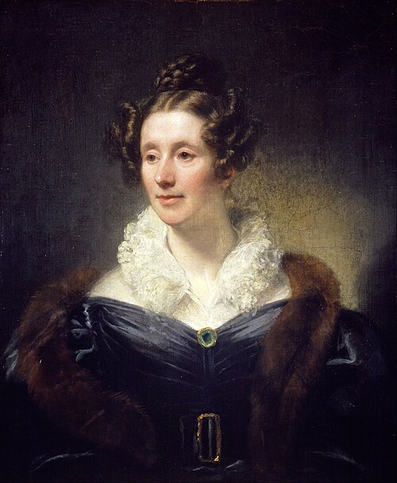

# 玛丽·萨默维尔

**英文名：** Mary Somerville

**生卒：** 1780年12月26日 — 1872年11月29日

**主要领域：** 数学物理、天体力学、科学传播

肖像的作者、拍摄或创作年代及具体形式见图片来源。

## 生平简介

苏格兰数学与科学作家，主要通过自学进入欧洲科学交流网络，晚年定居意大利。她以《天体机制》转述拉普拉斯数学天文学，并以《物理科学的联系》等著作综合光、热、电和天文知识。

## 对物理的主要贡献

- 以数学阐释拉普拉斯天体力学，促进高等数学物理的传播。
- 综合讨论物理学各领域之间的联系，并参与磁性与太阳光相关实验。

## 史料说明

- 其太阳光磁化实验的部分结论未能得到后来的可靠复现；贡献在于传播综合和研究实践，不能将该实验结论当作现代定论。

## 肖像来源与许可

- 来源：[Thomas_Phillips_-_Mary_Fairfax,_Mrs_William_Somerville,_1780_-_1872._Writer_on_science_-_Google_Art_Project.jpg](https://commons.wikimedia.org/wiki/File:Thomas_Phillips_-_Mary_Fairfax,_Mrs_William_Somerville,_1780_-_1872._Writer_on_science_-_Google_Art_Project.jpg)
- 作者／署名：Thomas Phillips
- 许可：Public domain
- 本地文件：[78bfe3c3056b1214ef4b-1a95028042.jpg](../portraits/78bfe3c3056b1214ef4b-1a95028042.jpg)
- 原始来源说明：vgGXxVhiio34ew at Google Cultural Institute maximum zoom level

## 资料来源

- [MacTutor History of Mathematics — Mary Somerville](https://mathshistory.st-andrews.ac.uk/Biographies/Somerville/)
- [Wikipedia — Mary Somerville](https://en.wikipedia.org/wiki/Mary_Somerville)

资料整理日期：2026-10-26。
