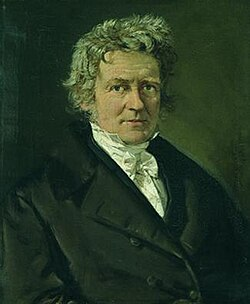

# 弗里德里希·贝塞尔

**英文名：** Friedrich Bessel

**生卒：** 1784年7月22日 — 1846年3月17日

**主要领域：** 天体测量、数学物理

肖像的作者、拍摄或创作年代及具体形式见图片来源。

## 生平简介

德意志天文学家，早年从商后转向天文，长期主持柯尼斯堡天文台。他把精密仪器、误差分析和数学计算结合，1838年测得天鹅座61的恒星视差，同时发展后来广泛用于物理的贝塞尔函数方法。

## 对物理的主要贡献

- 首次发表被广泛接受的可靠恒星视差测量，求得天鹅座61的距离。
- 研究天体位置、观测误差和贝塞尔函数，为天文学与数学物理提供工具。

## 肖像来源与许可

- 来源：[Friedrich_Wilhelm_Bessel_(1839_painting).jpg](https://commons.wikimedia.org/wiki/File:Friedrich_Wilhelm_Bessel_(1839_painting).jpg)
- 作者／署名：Christian Albrecht Jensen
- 许可：Public domain
- 本地文件：[bbdf2d1679e57ffb8b49-f0751ac174.jpg](../portraits/bbdf2d1679e57ffb8b49-f0751ac174.jpg)
- 原始来源说明：Ny Carlsberg Glyptotek

## 资料来源

- [MacTutor History of Mathematics — Friedrich Bessel](https://mathshistory.st-andrews.ac.uk/Biographies/Bessel/)
- [Wikipedia — Friedrich Bessel](https://en.wikipedia.org/wiki/Friedrich_Bessel)

资料整理日期：2026-10-26。
