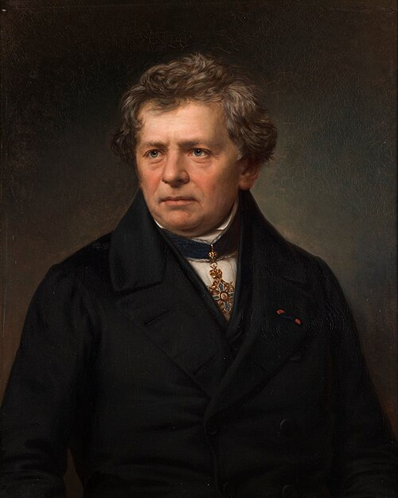

# 格奥尔格·西蒙·欧姆

**英文名：** Georg Ohm

**生卒：** 1789年3月16日 — 1854年7月6日

**主要领域：** 电路理论、导电物理

肖像的作者、拍摄或创作年代及具体形式见图片来源。

## 生平简介

德意志物理学家，早年在多所学校教授数学，利用教学实验室研究电路，后任纽伦堡及慕尼黑的教学职位。他借鉴热传导的数学形式，把电流、电压与导体性质联系起来，成果起初未获普遍认可。

## 对物理的主要贡献

- 建立一定条件下电流、电压和电阻之间的欧姆定律。
- 把电路导电过程数学化，为定量电路理论奠定基础。

## 肖像来源与许可

- 来源：[Georg_Simon_Ohm_(1789-1854).jpg](https://commons.wikimedia.org/wiki/File:Georg_Simon_Ohm_(1789-1854).jpg)
- 作者／署名：Original: unknown
- 许可：Public domain
- 本地文件：[afd05a0d41a1b45f2419.jpg](../portraits/afd05a0d41a1b45f2419.jpg)
- 原始来源说明：Bayerische Akademie der Wissenschaften https://www.facebook.com/badw.muenchen/photos/a.1504466919851549/2050320341932868/

## 资料来源

- [MacTutor History of Mathematics — Georg Ohm](https://mathshistory.st-andrews.ac.uk/Biographies/Ohm/)
- [Wikipedia — Georg Ohm](https://en.wikipedia.org/wiki/Georg_Ohm)

资料整理日期：2026-10-26。
