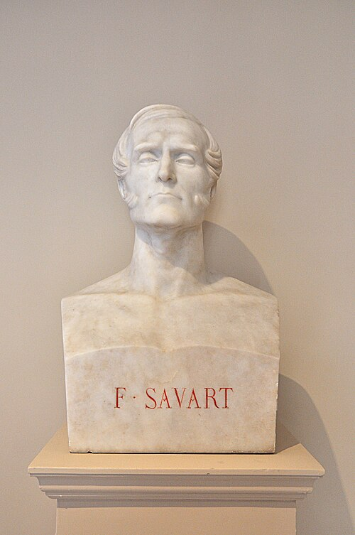

# 费利克斯·萨伐尔

**英文名：** Félix Savart

**生卒：** 1791年6月30日 — 1841年3月16日

**主要领域：** 电磁学、声学

位于巴黎法兰西学会的萨伐尔半身雕塑的现代照片。配图是雕塑肖像，不是本人的历史照片；尚未核实雕塑是否依据生前写生。

## 生平简介

法国医生和物理学家，早年任军医，后在巴黎研究声学、电磁学和乐器。他与毕奥共同测量电流对磁针的作用，也以振动、声波及材料实验连接音乐制作与定量物理。

## 对物理的主要贡献

- 与毕奥建立电流产生磁场的定量关系，即毕奥—萨伐尔定律。
- 研究弦、板和液体振动及声波干涉，发展实验声学。

## 肖像来源与许可

- 来源：[Interior_of_Institut_de_France,_Paris_6th_013.jpg](https://commons.wikimedia.org/wiki/File:Interior_of_Institut_de_France,_Paris_6th_013.jpg)
- 作者／署名：Moonik
- 许可：[CC BY-SA 3.0](https://creativecommons.org/licenses/by-sa/3.0)
- 本地文件：[9e1db00813c3f1b43145-fad82676e2.jpg](../portraits/9e1db00813c3f1b43145-fad82676e2.jpg)
- 原始来源说明：Own work

## 资料来源

- [MacTutor History of Mathematics — Félix Savart](https://mathshistory.st-andrews.ac.uk/Biographies/Savart/)
- [Wikipedia — Félix Savart](https://en.wikipedia.org/wiki/F%C3%A9lix_Savart)

资料整理日期：2026-10-26。
