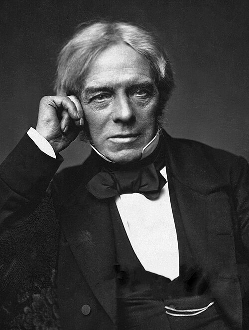

# 迈克尔·法拉第

**英文名：** Michael Faraday

**生卒：** 1791年9月22日 — 1867年8月25日

**主要领域：** 电磁学、电化学、场论史

肖像的作者、拍摄或创作年代及具体形式见图片来源。

## 生平简介

英国实验物理学家和化学家，少年为装订学徒，后进入皇家研究院，长期以精巧实验探索自然。他缺少高等数学训练，却通过电、磁、化学和光的联系形成场的直觉，对麦克斯韦的电磁理论影响深远。

## 对物理的主要贡献

- 发现电磁感应，奠定发电机和变压器的物理基础。
- 建立电解定律，联系电荷转移与物质变化。
- 发现磁致旋光并发展力线观念，推进电磁场思想。

## 肖像来源与许可

- 来源：[Michael_Faraday_sitting_crop.jpg](https://commons.wikimedia.org/wiki/File:Michael_Faraday_sitting_crop.jpg)
- 作者／署名：Unknown author
- 许可：Public domain
- 本地文件：[265f405d4fe6b4851ce2.jpg](../portraits/265f405d4fe6b4851ce2.jpg)
- 原始来源说明：[1]

## 资料来源

- [MacTutor History of Mathematics — Michael Faraday](https://mathshistory.st-andrews.ac.uk/Biographies/Faraday/)
- [Wikipedia — Michael Faraday](https://en.wikipedia.org/wiki/Michael_Faraday)

资料整理日期：2026-10-26。
