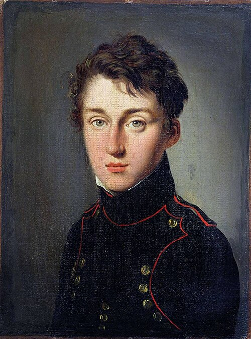

# 萨迪·卡诺

**英文名：** Nicolas Léonard Sadi Carnot

**生卒：** 1796年6月1日 — 1832年8月24日

**主要领域：** 热力学、热机理论

肖像的作者、拍摄或创作年代及具体形式见图片来源。

## 生平简介

法国军事工程师和物理研究者，毕业于巴黎综合理工学院，后在军职与独立研究之间辗转。他在1824年出版有关热动力的短著，以理想热机和可逆过程分析效率；其思想在去世后才得到充分发展。

## 对物理的主要贡献

- 提出卡诺循环及理想可逆热机概念。
- 指出热机效率受到热源与冷源条件的普遍限制，为热力学第二定律奠定基础。

## 史料说明

- 其1824年理论仍使用热质说语言，效率与可逆性思想后来由克拉佩龙、克劳修斯和开尔文等发展。

## 肖像来源与许可

- 来源：[Sadi_Carnot.jpeg](https://commons.wikimedia.org/wiki/File:Sadi_Carnot.jpeg)
- 作者／署名：Louis-Léopold Boilly (1761–1845)
- 许可：[Public domain](https://commons.wikimedia.org/wiki/Commons:Reuse_of_PD-Art_photographs)
- 本地文件：[c6f0f2a8c02e1d6f9b7f.jpeg](../portraits/c6f0f2a8c02e1d6f9b7f.jpeg)
- 原始来源说明：https://www.alamy.com/portrait-of-lazare-nicolas-marguerite-comte-carnot-1753-1823-museum-private-collection-image212355036.html

## 资料来源

- [MacTutor History of Mathematics — Nicolas Léonard Sadi Carnot](https://mathshistory.st-andrews.ac.uk/Biographies/Carnot_Sadi/)
- [Wikipedia — Nicolas Léonard Sadi Carnot](https://en.wikipedia.org/wiki/Nicolas_L%C3%A9onard_Sadi_Carnot)

资料整理日期：2026-10-26。
