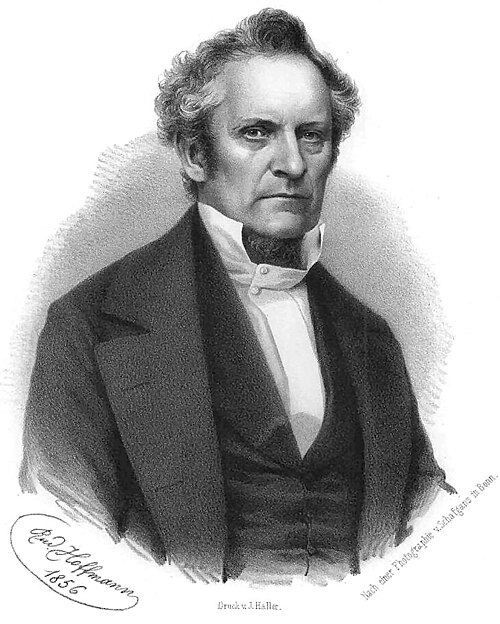

# 尤利乌斯·普吕克尔

**英文名：** Julius Plücker

**生卒：** 1801年7月16日 — 1868年5月22日

**主要领域：** 气体放电、光谱学、数学物理

肖像的作者、拍摄或创作年代及具体形式见图片来源。

## 生平简介

德国数学家和实验物理学家，长期任教于波恩大学。早期研究解析几何，后来转向磁学、气体放电和光谱实验；他把几何研究与精密实验结合起来，是十九世纪阴极射线研究的先驱之一。

## 对物理的主要贡献

- 研究低压气体放电及阴极射线在磁场中的偏转
- 与希托夫研究气体光谱，为光谱学和电子发现的前史提供实验基础
- 发展线几何，形成后来数学物理使用的重要几何工具

## 肖像来源与许可

- 来源：[Julius_Plücker.jpg](https://commons.wikimedia.org/wiki/File:Julius_Pl%C3%BCcker.jpg)
- 作者／署名：Rudolf Hoffmann (Lithograph), nach einer Photographie von Schafgans in Bonn.
- 许可：Public domain
- 本地文件：[e9d842af8dd20230dac5.jpg](../portraits/e9d842af8dd20230dac5.jpg)
- 原始来源说明：[1]; transferred from en.wikipedia; description page was here 10:04, 15 June 2004 Magnus Manske 728x909 (133,849 bytes)

## 资料来源

- [Julius Plücker — MacTutor, University of St Andrews](https://mathshistory.st-andrews.ac.uk/Biographies/Plucker/)
- [Julius Plücker — Wikipedia（生卒日期与人物概述）](https://en.wikipedia.org/wiki/Julius_Pl%C3%BCcker)

资料整理日期：2026-10-26。
