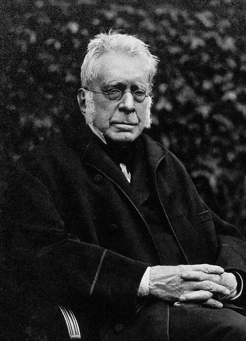

# 乔治·比德尔·艾里

**英文名：** George Biddell Airy

**生卒：** 1801年7月27日 — 1892年1月2日

**主要领域：** 光学、弹性力学、地球物理

肖像的作者、拍摄或创作年代及具体形式见图片来源。

## 生平简介

英国天文学家和数学物理学家，曾任剑桥大学教授，后长期担任皇家天文学家并主持格林尼治天文台。他既从事精密天文观测，也研究光学、弹性力学和地球物理，推动了十九世纪观测标准化。

## 对物理的主要贡献

- 研究圆孔衍射，给出艾里斑及其强度分布
- 建立二维弹性问题中的艾里应力函数方法
- 提出地壳均衡模型，并通过重力测量研究地球密度

## 肖像来源与许可

- 来源：[George_Biddell_Airy_1891.jpg](https://commons.wikimedia.org/wiki/File:George_Biddell_Airy_1891.jpg)
- 作者／署名：Morgan & Kidd
- 许可：[CC BY 4.0](https://commons.wikimedia.org/wiki/File:George_Biddell_Airy_1891.jpg)
- 本地文件：[ca02f6137a1e38b2e0ed.jpg](../portraits/ca02f6137a1e38b2e0ed.jpg)
- 原始来源说明：[1]

## 资料来源

- [George Biddell Airy — MacTutor, University of St Andrews](https://mathshistory.st-andrews.ac.uk/Biographies/Airy/)
- [George Biddell Airy — Wikipedia（生卒日期与人物概述）](https://en.wikipedia.org/wiki/George_Biddell_Airy)

资料整理日期：2026-10-26。
