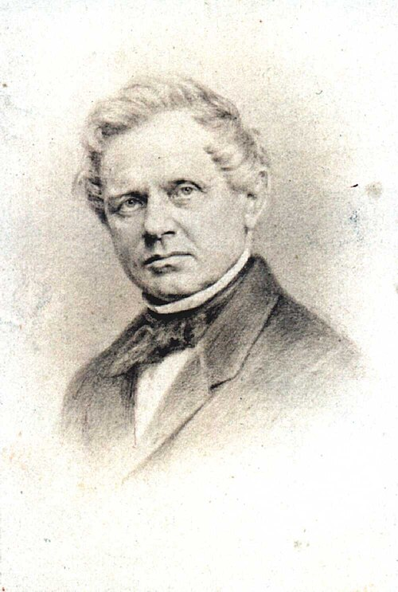

# 古斯塔夫·马格努斯

**英文名：** Heinrich Gustav Magnus

**生卒：** 1802年5月2日 — 1870年4月4日

**主要领域：** 流体力学、热学、实验物理

肖像的作者、拍摄或创作年代及具体形式见图片来源。

## 生平简介

德国实验物理学家，早年受化学训练，长期在柏林大学开展研究与实验教学。他为年轻研究者建立实验训练环境，研究气体、热学与流体运动；其姓名保留在旋转物体受力的马格努斯效应中。

## 对物理的主要贡献

- 通过实验研究旋转物体在流体中的横向受力，即马格努斯效应
- 研究气体膨胀、蒸气压及物质热性质
- 推动柏林实验物理教学和实验室研究制度的发展

## 肖像来源与许可

- 来源：[Heinrich_Gustav_Magnus.jpg](https://commons.wikimedia.org/wiki/File:Heinrich_Gustav_Magnus.jpg)
- 作者／署名：见原图页面
- 许可：[Public domain](https://commons.wikimedia.org/wiki/Commons:Reuse_of_PD-Art_photographs)
- 本地文件：[d81ae3d40e9647ad319d.jpg](../portraits/d81ae3d40e9647ad319d.jpg)

## 资料来源

- [Heinrich Gustav Magnus — Wikipedia（生卒日期与人物概述）](https://en.wikipedia.org/wiki/Heinrich_Gustav_Magnus)

资料整理日期：2026-10-26。
