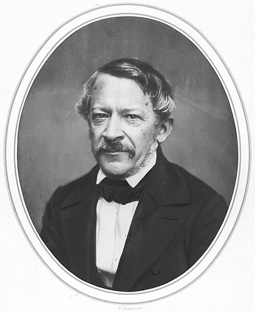

# 海因里希·威廉·多夫

**英文名：** Heinrich Wilhelm Dove

**生卒：** 1803年10月6日 — 1879年4月4日

**主要领域：** 气象物理、声学、光学

肖像的作者、拍摄或创作年代及具体形式见图片来源。

## 生平简介

德国物理学家和气象学家，长期在柏林从事教学与观测组织工作。他把气象资料比较与物理解释结合起来，研究风向、温度分布和声学现象，是十九世纪气象学走向系统观测的重要推动者。

## 对物理的主要贡献

- 研究大气环流和风向变化规律，推动气象观测比较
- 发现双耳分别接收近频声音时的双耳拍频现象
- 研究光的偏振及相关光学实验装置

## 肖像来源与许可

- 来源：[Heinrich_Wilhelm_Dove_1857.jpg](https://commons.wikimedia.org/wiki/File:Heinrich_Wilhelm_Dove_1857.jpg)
- 作者／署名：见原图页面
- 许可：[Public domain](https://commons.wikimedia.org/wiki/File:Heinrich_Wilhelm_Dove_1857.jpg)
- 本地文件：[5786dc76d259b27b1431.jpg](../portraits/5786dc76d259b27b1431.jpg)
- 原始来源说明：http://www.sil.si.edu/digitalcollections/hst/scientific-identity/explore.htm (reworked)

## 资料来源

- [Heinrich Wilhelm Dove — Wikipedia（生卒日期与人物概述）](https://en.wikipedia.org/wiki/Heinrich_Wilhelm_Dove)

资料整理日期：2026-10-26。
