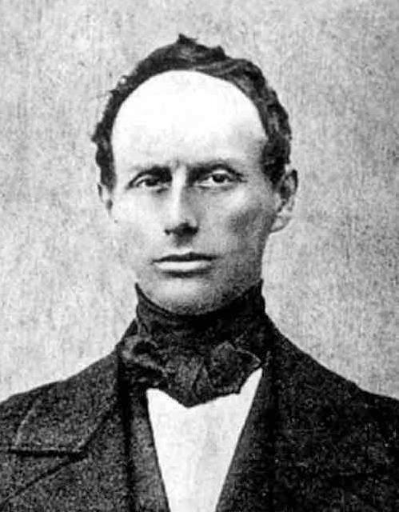

# 克里斯蒂安·多普勒

**英文名：** Christian Doppler

**生卒：** 1803年11月29日 — 1853年3月17日

**主要领域：** 波动物理、声学、光学

肖像的作者、拍摄或创作年代及具体形式见图片来源。

## 生平简介

奥地利物理学家和数学家，曾在布拉格、班斯卡什佳夫尼察和维也纳任教，晚年主持维也纳的物理研究机构。他从波动传播讨论光源运动与颜色变化，提出后来广泛用于声学、光学与天文学的频移原理。

## 对物理的主要贡献

- 提出波源和观察者相对运动会改变接收频率的原理，即多普勒效应
- 把波动频移问题引入恒星光的研究
- 为后来的速度测量、光谱天文学和雷达测速提供理论基础

## 肖像来源与许可

- 来源：[Christian_Doppler.jpg](https://commons.wikimedia.org/wiki/File:Christian_Doppler.jpg)
- 作者／署名：Unknown author
- 许可：Public domain
- 本地文件：[e7e5227f7bcf823ff326.jpg](../portraits/e7e5227f7bcf823ff326.jpg)
- 原始来源说明：http://www.scientificlib.com

## 资料来源

- [Christian Doppler — MacTutor, University of St Andrews](https://mathshistory.st-andrews.ac.uk/Biographies/Doppler/)
- [Christian Doppler — Wikipedia（生卒日期与人物概述）](https://en.wikipedia.org/wiki/Christian_Doppler)

资料整理日期：2026-10-26。
