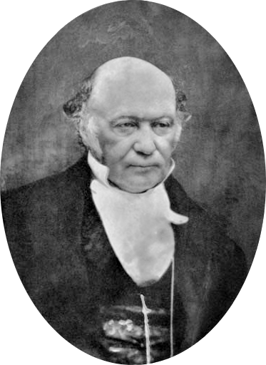

# 威廉·罗恩·哈密顿

**英文名：** William Rowan Hamilton

**生卒：** 1805年8月4日 — 1865年9月2日

**主要领域：** 经典力学、光学、数学物理

肖像的作者、拍摄或创作年代及具体形式见图片来源。

## 生平简介

爱尔兰数学家、天文学家和数学物理学家，青年时即任都柏林三一学院安德鲁斯天文学教授，并主持邓辛克天文台。他把光线传播和力学运动纳入共同的变分语言，奠定现代分析力学的重要基础。

## 对物理的主要贡献

- 建立哈密顿力学，以广义坐标和共轭动量描述动力学
- 发展光学与力学之间的形式联系，并预言圆锥折射
- 创立四元数，为空间旋转及后来的理论物理提供代数工具

## 肖像来源与许可

- 来源：[William_Rowan_Hamilton_portrait_oval_combined.png](https://commons.wikimedia.org/wiki/File:William_Rowan_Hamilton_portrait_oval_combined.png)
- 作者／署名：William_Rowan_Hamilton_portrait_oval.png: Unknown William_Rowan_Hamilton_portrait_oval_2.png: Unknown derivative work: Quibik (talk)
- 许可：[Public domain](https://commons.wikimedia.org/wiki/File:William_Rowan_Hamilton_portrait_oval_combined.png)
- 本地文件：[23e65162fb5cd093654a.png](../portraits/23e65162fb5cd093654a.png)
- 原始来源说明：William_Rowan_Hamilton_portrait_oval.png William_Rowan_Hamilton_portrait_oval_2.png

## 资料来源

- [William Rowan Hamilton — MacTutor, University of St Andrews](https://mathshistory.st-andrews.ac.uk/Biographies/Hamilton/)
- [William Rowan Hamilton — Wikipedia（生卒日期与人物概述）](https://en.wikipedia.org/wiki/William_Rowan_Hamilton)

资料整理日期：2026-10-26。
