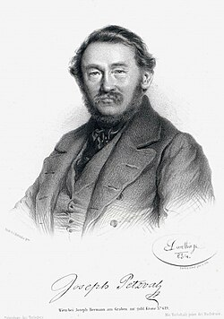

# 约瑟夫·佩兹伐尔

**英文名：** Joseph Petzval

**生卒：** 1807年1月6日 — 1891年9月17日

**主要领域：** 应用光学、成像物理

肖像的作者、拍摄或创作年代及具体形式见图片来源。

## 生平简介

出生于今斯洛伐克地区的数学家和光学研究者，长期在维也纳大学任教。他把数学计算用于摄影镜头设计，与工匠合作改进成像仪器，使早期摄影能够以更大光圈和更短曝光时间拍摄肖像。

## 对物理的主要贡献

- 设计高光通量的佩兹伐尔肖像镜头，显著缩短早期摄影曝光时间
- 研究光学系统像差与像面弯曲，形成佩兹伐尔场曲条件
- 推动镜头设计由经验试制转向数学计算

## 肖像来源与许可

- 来源：[Joseph_Petzval.jpg](https://commons.wikimedia.org/wiki/File:Joseph_Petzval.jpg)
- 作者／署名：Adolf Dauthage
- 许可：Public domain
- 本地文件：[1348b3cc2e34ecd8dcc0.jpg](../portraits/1348b3cc2e34ecd8dcc0.jpg)
- 原始来源说明：http://www.sil.si.edu/digitalcollections/hst/scientific-identity/explore.htm

## 资料来源

- [Joseph Petzval — MacTutor, University of St Andrews](https://mathshistory.st-andrews.ac.uk/Biographies/Petzval/)
- [Joseph Petzval — Wikipedia（生卒日期与人物概述）](https://en.wikipedia.org/wiki/Joseph_Petzval)

资料整理日期：2026-10-26。
