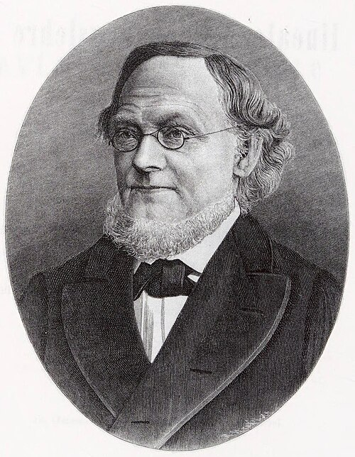

# 赫尔曼·格拉斯曼

**英文名：** Hermann Grassmann

**生卒：** 1809年4月15日 — 1877年9月26日

**主要领域：** 数学物理、向量与外代数

肖像的作者、拍摄或创作年代及具体形式见图片来源。

## 生平简介

德国数学家和语言学家，长期在什切青担任中学教师。他在学术机构之外发展抽象空间和扩张理论，生前数学成果未获充分理解，后来成为向量代数、外代数及现代物理数学语言的重要来源。

## 对物理的主要贡献

- 发展一般维数空间中的向量运算和外代数
- 以扩张理论处理几何量及其组合，为微分形式和场论提供数学基础
- 格拉斯曼代数后来成为描述费米变量等物理对象的重要工具

## 史料说明

- 主要身份为数学家
- 其贡献属于物理学的数学基础，不应归为费米子理论的直接发现者。

## 肖像来源与许可

- 来源：[Hermann_Grassmann_etching.jpg](https://commons.wikimedia.org/wiki/File:Hermann_Grassmann_etching.jpg)
- 作者／署名：Unknown author
- 许可：[Public domain](https://en.wikipedia.org/wiki/public_domain)
- 本地文件：[d5184b7530b31d60183b.jpg](../portraits/d5184b7530b31d60183b.jpg)
- 原始来源说明：From the beginning of vol. 1 of Grassmann's collected works (1894)

## 资料来源

- [Hermann Grassmann — MacTutor, University of St Andrews](https://mathshistory.st-andrews.ac.uk/Biographies/Grassmann/)
- [Hermann Grassmann — Wikipedia（生卒日期与人物概述）](https://en.wikipedia.org/wiki/Hermann_Grassmann)

资料整理日期：2026-10-26。
