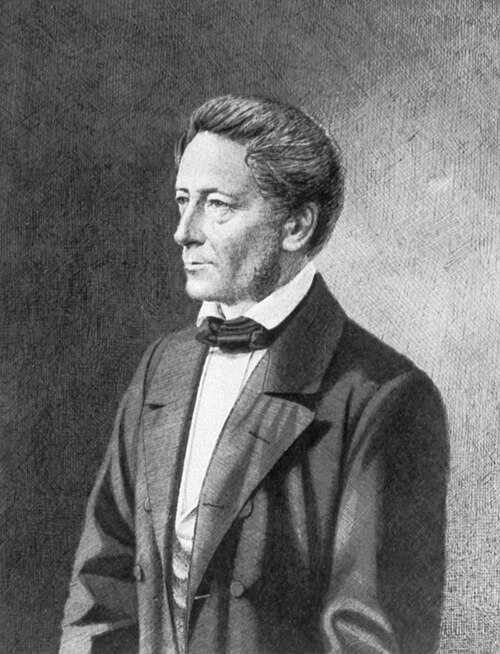

# 鲁道夫·科尔劳施

**英文名：** Rudolf Kohlrausch

**生卒：** 1809年11月6日 — 1858年3月（8日或9日记载不一）

**主要领域：** 电磁学、介电物理、计量学

肖像的作者、拍摄或创作年代及具体形式见图片来源。

## 生平简介

德国物理学家，先后在中学和大学从事数学物理教学与实验研究。他以电学测量见长，与威廉·韦伯合作比较不同电学单位体系；其子弗里德里希后来亦成为著名的精密实验物理学家。

## 对物理的主要贡献

- 与韦伯测量静电与电磁单位之间的比值，提供电磁量与光速关系的实验线索
- 研究介电弛豫并提出描述衰减过程的经验函数
- 发展静电测量及电学计量方法

## 史料说明

- 逝世日期存在1858年3月8日与9日两种记载，故只记到月；埃尔朗根教授名录记8日，马尔堡教授名录及《德意志通传》正文记9日。德意志人物传记目录年份1859又与同页正文1858不一致，不采用该目录年份。

## 肖像来源与许可

- 来源：[Rudolf_Kohlrausch.jpg](https://commons.wikimedia.org/wiki/File:Rudolf_Kohlrausch.jpg)
- 作者／署名：Der Bischof mit der E-Gitarre
- 许可：[Public domain](https://commons.wikimedia.org/wiki/Commons:Reuse_of_PD-Art_photographs)
- 本地文件：[70173761948973d40e42-8b4981fbdb.jpg](../portraits/70173761948973d40e42-8b4981fbdb.jpg)
- 原始来源说明：de.wikipedia

## 资料来源

- [Rudolf Kohlrausch — Deutsche Biographie](https://www.deutsche-biographie.de/sfz44125.html)
- [Rudolf Kohlrausch — Wikipedia biography](https://en.wikipedia.org/wiki/Rudolf_Kohlrausch)
- [Erlangen professors catalogue — Rudolf Kohlrausch, p.114](https://d-nb.info/1056019476/34)
- [Rudolf Kohlrausch — Marburg Professors Catalogue](https://professorenkatalog.online.uni-marburg.de/de/pkat/gndrec?id=118864580)

资料整理日期：2026-10-26。
