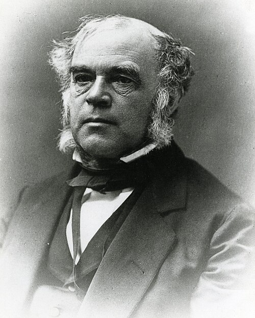

# 约翰·威廉·德雷珀

**英文名：** John William Draper

**生卒：** 1811年5月5日 — 1882年1月4日

**主要领域：** 光化学、热辐射、科学摄影

肖像的作者、拍摄或创作年代及具体形式见图片来源。

## 生平简介

英国出生的美国化学家、物理学家和摄影先驱，长期在纽约大学研究并教学。他把化学作用、光谱与摄影联系起来，留下早期月面摄影成果，并通过热辐射和光化学实验推动物理与化学交叉研究。

## 对物理的主要贡献

- 提出只有被吸收的光才能引起光化学变化的相关原理
- 研究高温物体开始发出可见光的条件，即德雷珀点
- 开展早期天文摄影和太阳光谱实验

## 肖像来源与许可

- 来源：[John_William_Draper.jpg](https://commons.wikimedia.org/wiki/File:John_William_Draper.jpg)
- 作者／署名：Edward Bierstadt (1824–1906)
- 许可：[Public domain](https://commons.wikimedia.org/wiki/File:John_William_Draper.jpg)
- 本地文件：[fd5633480d115fb37b07-f008ec31fe.jpg](../portraits/fd5633480d115fb37b07-f008ec31fe.jpg)
- 原始来源说明：Smithsonian Institution, National Museum of American History, Archives Center, Draper Family Collection. [1]

## 资料来源

- [Draper Family Papers — New York University Special Collections](https://findingaids.library.nyu.edu/archives/mc_11/all/)
- [John William Draper — Wikipedia biography](https://en.wikipedia.org/wiki/John_William_Draper)

资料整理日期：2026-10-26。
