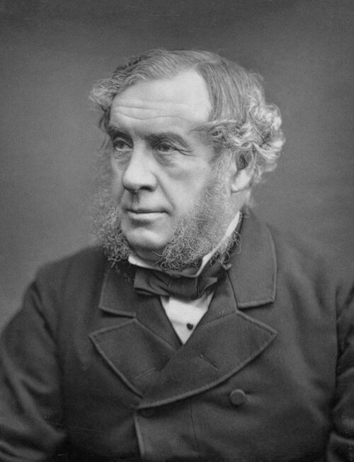

# 威廉·罗伯特·格罗夫

**英文名：** William Robert Grove

**生卒：** 1811年7月11日 — 1896年8月1日

**主要领域：** 电化学、能量转化、实验物理

肖像的作者、拍摄或创作年代及具体形式见图片来源。

## 生平简介

英国律师和实验科学家，曾在伦敦研究机构任教，兼顾法律职业与电化学研究。他研究电池、电解和能量之间的联系，强调不同自然作用能够相互转化，是能量统一观念形成时期的重要人物。

## 对物理的主要贡献

- 制成早期气体电池，即燃料电池的先驱
- 提出并推广热、光、电、磁和机械作用相互关联与转化的观念
- 改进电化学电池，促进十九世纪电学实验

## 肖像来源与许可

- 来源：[William_Robert_Grove_2.jpg](https://commons.wikimedia.org/wiki/File:William_Robert_Grove_2.jpg)
- 作者／署名：Lock & Whitfield (active 1856-1894)
- 许可：[Public domain](https://commons.wikimedia.org/wiki/File:William_Robert_Grove_2.jpg)
- 本地文件：[33ee2dacdc6e49e319ef.jpg](../portraits/33ee2dacdc6e49e319ef.jpg)
- 原始来源说明：NPG

## 资料来源

- [William Robert Grove — Wikipedia（生卒日期与人物概述）](https://en.wikipedia.org/wiki/William_Robert_Grove)

资料整理日期：2026-10-26。
