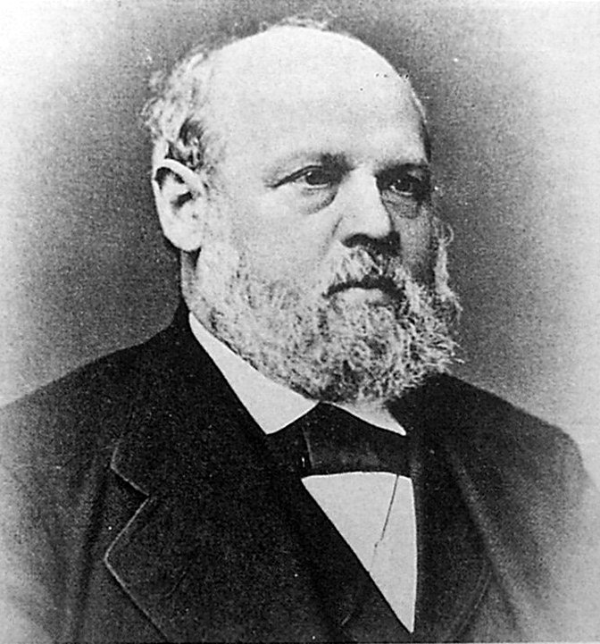

# 海因里希·盖斯勒

**英文名：** Heinrich Geissler

**生卒：** 1814年5月26日 — 1879年1月24日

**主要领域：** 实验技术、气体放电、真空物理

肖像的作者、拍摄或创作年代及具体形式见图片来源。

## 生平简介

德国玻璃仪器制造师和实验技术先驱，长期在波恩工作，与普吕克尔等研究者合作。他以精巧玻璃工艺和抽气技术制作低压放电装置，使稀薄气体中的发光和电流现象成为可反复研究的实验对象。

## 对物理的主要贡献

- 改进水银真空泵，为低压气体实验提供条件
- 研制盖斯勒放电管，推动气体放电和阴极射线研究
- 通过精密玻璃仪器制造促进十九世纪实验物理的发展

## 肖像来源与许可

- 来源：[Heinrich_Geissler.jpg](https://commons.wikimedia.org/wiki/File:Heinrich_Geissler.jpg)
- 作者／署名：见原图页面
- 许可：[Public domain](https://commons.wikimedia.org/wiki/File:Heinrich_Geissler.jpg)
- 本地文件：[5263c455ad9d69c9ea6d-bc181d174e.jpg](../portraits/5263c455ad9d69c9ea6d-bc181d174e.jpg)

## 资料来源

- [Heinrich Geissler — Neue Deutsche Biographie](https://www.deutsche-biographie.de/pnd116541954.html?language=de)
- [Heinrich Geissler — Wikipedia biography](https://en.wikipedia.org/wiki/Heinrich_Geissler)

资料整理日期：2026-10-26。
