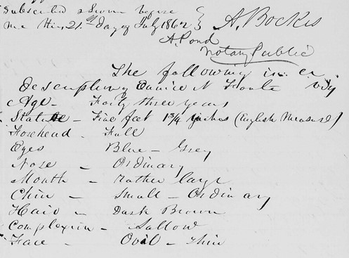

# 尤妮斯·牛顿·富特

**英文名：** Eunice Newton Foote

**生卒：** 1819年7月17日 — 1888年9月30日

**主要领域：** 大气物理、热学、实验物理

护照中的外貌描述页，并非肖像；尚未取得可核实的人物肖像。

## 生平简介

美国实验研究者、发明家和妇女权利倡导者，曾接受科学教育，在家中开展气体受日光加热的比较实验。她于1856年提出大气中较多二氧化碳可能提高地球温度，成果长期未获应有关注。

## 对物理的主要贡献

- 比较不同气体在日照下的升温与冷却，发现二氧化碳样品具有显著差异
- 提出大气二氧化碳含量变化会影响地球温度的早期观点
- 研究空气的电学现象，是早期在物理领域发表成果的美国女性之一

## 史料说明

- 其装置比较气体的日照加热和冷却，不能等同于对大气温室效应全部过程或红外吸收谱的直接测量。
- 尚未取得可核实肖像，现存护照中的外貌描述页用作相关资料图，不是本人肖像。

## 肖像来源与许可

- 来源：[Passport_description_of_Foote.jpg](https://commons.wikimedia.org/wiki/File:Passport_description_of_Foote.jpg)
- 作者／署名：A. Bockes, A Pond (creators of the text)
- 许可：[Public domain](https://commons.wikimedia.org/wiki/File:Passport_description_of_Foote.jpg)
- 本地文件：[48547de57ecdcc4bce7b-af02d01adb.jpg](../portraits/48547de57ecdcc4bce7b-af02d01adb.jpg)
- 原始来源说明：Passport Applications, National Archives and Records Administration, Vol. 233 July 14-24, 1862. (NARA Series M1372, Roll 108)

## 资料来源

- [Eunice Foote’s 1856 experiments — Ortiz and Jackson, Notes and Records](https://doi.org/10.1098/rsnr.2020.0031)
- [Eunice Newton Foote — Wikipedia biography](https://en.wikipedia.org/wiki/Eunice_Newton_Foote)
- [August 1856: Eunice Foote and atmospheric warming — American Physical Society](https://www.aps.org/apsnews/2023/07/carbon-dioxide-atmosphere-eunice-foote)

资料整理日期：2026-10-26。
