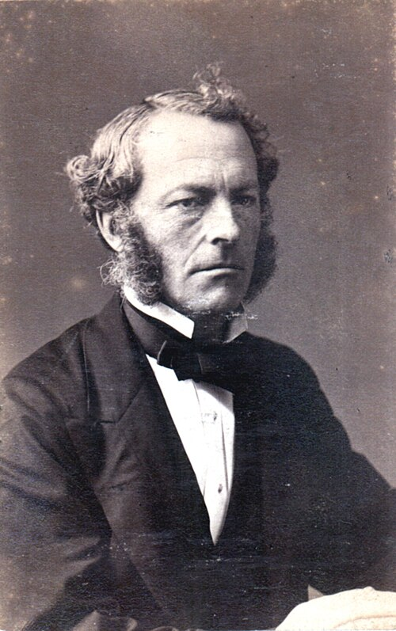

# 乔治·加布里埃尔·斯托克斯

**英文名：** George Gabriel Stokes

**生卒：** 1819年8月13日 — 1903年2月1日

**主要领域：** 流体力学、光学、数学物理

肖像的作者、拍摄或创作年代及具体形式见图片来源。

## 生平简介

出生于爱尔兰的英国数学家和物理学家，长期任剑桥大学卢卡斯数学教授，并曾任英国皇家学会会长。他把数学分析用于流体、光与振动现象，是十九世纪连续介质力学和物理光学的代表人物。

## 对物理的主要贡献

- 发展黏性流体运动方程及低雷诺数下小球阻力定律
- 研究荧光，发现发射光通常比激发光波长更长的规律，后称斯托克斯位移
- 用斯托克斯参量描述光的偏振状态

## 肖像来源与许可

- 来源：[Portrait_of_George_Gabriel_Stokes_(1819-1903),_Physicist_and_Mathematician_(2551115803).jpg](https://commons.wikimedia.org/wiki/File:Portrait_of_George_Gabriel_Stokes_%281819-1903%29%2C_Physicist_and_Mathematician_%282551115803%29.jpg)
- 作者／署名：Smithsonian Institution from United States
- 许可：[No restrictions](https://commons.wikimedia.org/wiki/File:Portrait_of_George_Gabriel_Stokes_%281819-1903%29%2C_Physicist_and_Mathematician_%282551115803%29.jpg)
- 本地文件：[d01a1dc98f157ea8a6de.jpg](../portraits/d01a1dc98f157ea8a6de.jpg)
- 原始来源说明：Portrait of George Gabriel Stokes (1819-1903), Physicist and Mathematician

## 资料来源

- [George Gabriel Stokes — MacTutor, University of St Andrews](https://mathshistory.st-andrews.ac.uk/Biographies/Stokes/)
- [George Gabriel Stokes — Wikipedia（生卒日期与人物概述）](https://en.wikipedia.org/wiki/George_Gabriel_Stokes)

资料整理日期：2026-10-26。
