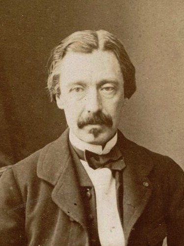

# 莱昂·傅科

**英文名：** Léon Foucault

**生卒：** 1819年9月18日 — 1868年2月11日

**主要领域：** 经典力学、光学、电磁学

肖像的作者、拍摄或创作年代及具体形式见图片来源。

## 生平简介

法国实验物理学家，早年接触医学与摄影，后专注物理仪器和光学研究。他在巴黎开展实验，以摆的运动直观显示地球自转，并用高速旋转装置研究光传播；其工作体现了精巧实验设计的力量。

## 对物理的主要贡献

- 用傅科摆直接演示地球自转，并发展陀螺仪实验
- 改进旋转镜测光速方法，比较光在空气和水中的传播
- 研究导体中的涡电流，即傅科电流

## 肖像来源与许可

- 来源：[Foucault_portre_crop.jpg](https://commons.wikimedia.org/wiki/File:Foucault_portre_crop.jpg)
- 作者／署名：Bertall & Cie. Fizped
- 许可：[Public domain](https://commons.wikimedia.org/wiki/File:Foucault_portre_crop.jpg)
- 本地文件：[af8281db88b2328c1a52.jpg](../portraits/af8281db88b2328c1a52.jpg)
- 原始来源说明：Derivated work from File:Portrait_Leon_Foucault_1882.jpg http://gallica.bnf.fr/ark:/12148/btv1b8449954m

## 资料来源

- [Léon Foucault — MacTutor, University of St Andrews](https://mathshistory.st-andrews.ac.uk/Biographies/Foucault/)
- [Léon Foucault — Wikipedia（生卒日期与人物概述）](https://en.wikipedia.org/wiki/L%C3%A9on_Foucault)

资料整理日期：2026-10-26。
