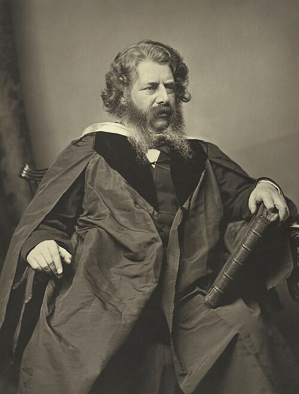

# 威廉·约翰·麦夸恩·兰金

**英文名：** William John Macquorn Rankine

**生卒：** 1820年7月5日 — 1872年12月24日

**主要领域：** 热力学、工程物理、力学

肖像的作者、拍摄或创作年代及具体形式见图片来源。

## 生平简介

苏格兰工程师和物理学家，曾从事铁路工程，后任格拉斯哥大学工程教授。他把热学、力学与工程设计系统结合，编写有影响的教材；兰金循环和温标保留了他在热力学及其应用中的贡献。

## 对物理的主要贡献

- 参与建立热力学的理论体系并研究热机效率
- 提出分析蒸汽动力装置的兰金循环
- 发展工程力学及波动研究，促进物理定律在工程中的系统应用

## 肖像来源与许可

- 来源：[William_John_Macquorn_Rankine_by_Thomas_Annan.jpg](https://commons.wikimedia.org/wiki/File:William_John_Macquorn_Rankine_by_Thomas_Annan.jpg)
- 作者／署名：Thomas Annan (1829–1887)
- 许可：[Public domain](https://commons.wikimedia.org/wiki/Commons:Reuse_of_PD-Art_photographs)
- 本地文件：[545af70ed1ebb52cd66f.jpg](../portraits/545af70ed1ebb52cd66f.jpg)
- 原始来源说明：National Galleries of Scotland, accession number: PGP R 2115.24

## 资料来源

- [William John Macquorn Rankine — MacTutor, University of St Andrews](https://mathshistory.st-andrews.ac.uk/Biographies/Rankine/)
- [William John Macquorn Rankine — Wikipedia（生卒日期与人物概述）](https://en.wikipedia.org/wiki/William_John_Macquorn_Rankine)

资料整理日期：2026-10-26。
